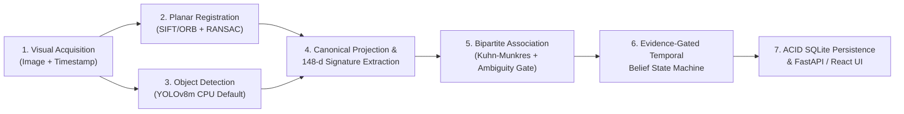

# ObjectMemory: Long-Term Visual Memory for Detecting Persistent Environmental Changes

**Final Academic Project Report**  
**System Version:** 2.0 (YOLOv8m Production Default)  
**Date:** November 25, 2026  

---

## 1. Abstract

Frame-by-frame object detectors process each incoming image in isolation, lacking persistent memory across repeated visits to a physical environment. Consequently, transient detector false negatives, temporary occlusions, shadows, and camera viewpoint shifts are frequently misinterpreted as physical object removals, while relocated objects returning to their baseline positions are fragmented into new identities.

This project presents **ObjectMemory**, a seven-stage visual memory framework designed to detect, track, and explain persistent environmental changes in planar tabletop and workbench settings. ObjectMemory decouples ephemeral per-frame detections (`Observation`) from persistent entity beliefs (`WorkbenchEntity`), combining SIFT/ORB planar homography co-registration with geometric quality gating, CPU-executable object detection (**YOLOv8m** production default, with **YOLOv8n** and **YOLO26m** alternatives), 148-dimensional HSV-gradient appearance descriptors, Kuhn-Munkres bipartite spatial-temporal association, and evidence-gated temporal reasoning backed by visual patch vacancy verification and an ACID-compliant SQLite audit ledger.

Evaluated on a 6-scenario, 30-observation, 183-annotation physical pilot benchmark (`data/physical_pilot_v2/manifest_v2.json`), upgrading from YOLOv8n (30.60% state accuracy, 27.12% recall, 6 false removals) to pretrained YOLOv8m raised end-to-end state accuracy to **89.07% (163/183)**, detection recall to **90.40% (160/177)**, precision to **95.24% (160/168)**, and identity consistency to **89.39% (160/179)**, while reducing false removals to **0.56% (1/180)**. Furthermore, correcting a Visit-1 baseline state-retrieval bug in the Track B Oracle evaluator raised Oracle state accuracy from 76.50% (140/183) to **96.17% (176/183)** with 0 identity switches, confirming that the underlying temporal reasoning engine operates near its theoretical ceiling when supplied with reliable detections.

---

## 2. Problem Statement and Motivation

Autonomous workbench assistants, laboratory monitoring systems, and domestic service robots must maintain an accurate, auditable model of where physical objects reside across discrete, non-continuous visits separated by minutes, hours, or days. Although modern deep object detectors achieve strong single-frame accuracy on static benchmarks such as MS COCO, deploying them directly for longitudinal change detection introduces four structural failure modes:

1. **Memoryless Epistemology:** A standard detector produces an unordered set of bounding boxes $\mathcal{D}_t$ for frame $I_t$. If a tool is temporarily occluded or missed due to lighting variation, a naive frame-differencing pipeline concludes the object was physically removed.
2. **Coordinate Frame Drift:** Handheld or re-mounted cameras rarely reproduce identical viewpoints across visits. Pixel-space comparisons without geometric co-registration misclassify camera motion as object relocation.
3. **Identity Fragmentation:** When an object is moved to a temporary location and later returned to its original spot, memoryless or purely spatial trackers fail to reconcile the return event, spawning duplicate entity records.
4. **Unexplained Transitions:** Practical inspection workflows require auditable rationales (e.g., displacement in canonical pixels, registration quality, and vacancy evidence) rather than opaque binary change flags.

---

## 3. Objectives

1. **Decouple Observation from Belief:** Separate transient per-frame sensor detections from persistent entity states (`CONFIRMED_PRESENT`, `CONFIRMED_MOVED`, `PENDING_REMOVAL`, `CONFIRMED_REMOVED`, `INSUFFICIENT_EVIDENCE`, `AMBIGUOUS_IDENTITY`).
2. **Normalize Camera Viewpoints Safely:** Implement 2D planar homography co-registration with explicit quality gates so unreliable alignments freeze absence-based transitions rather than corrupting memory.
3. **Eliminate Spurious Removals:** Require multi-visit absence confirmation ($\ge 2$ consecutive reliably registered visits) combined with visual patch vacancy verification before confirming object removal.
4. **Preserve Continuous Identities:** Maintain cross-visit entity identity through relocation and return-to-baseline events using optimal bipartite matching over spatial and appearance cues.
5. **Deliver a Complete Full-Stack System:** Provide an ACID-compliant SQLite persistence layer, FastAPI REST backend, and React 18 web dashboard executing on standard CPU hardware, validated via automated tests and controlled physical-pilot experiments.

---

## 4. Related-Work Positioning

ObjectMemory sits at the intersection of three established computer vision areas:

- **Single-Frame Object Detection:** Anchor-free real-time detectors such as Ultralytics **YOLOv8** [1] and **YOLO26m** provide bounding boxes and semantic labels per frame, but lack temporal state persistence. ObjectMemory treats these detectors as interchangeable front-end sensors via `DetectorRegistry`.
- **Planar Image Registration & Multi-Object Tracking:** Classical local feature descriptors (**SIFT** [4], **ORB** [5]) paired with **RANSAC** [6] homography estimation align planar scenes across viewpoint changes. Unlike short-term video trackers that assume high-frame-rate temporal continuity (e.g., 30 FPS optical flow or Kalman filtering), ObjectMemory targets **episodic, asynchronous visits** where objects may jump arbitrarily between frames, solving cross-visit assignment via the **Kuhn-Munkres** optimal bipartite matching algorithm [7, 8].
- **Planar Change Detection & 3D Boundaries:** ObjectMemory intentionally scopes its geometry to **dominant planar surfaces** (workbenches and tabletops), trading unconstrained 3D reconstruction for lightweight CPU-only execution and deterministic geometric gating, while evaluating non-planar failure boundaries on supplementary benchmarks like **ETH ASL Lounge** [9].

---

## 5. Seven-Stage Architecture

ObjectMemory processes each incoming visit $t$ through a strictly ordered seven-stage pipeline:

1. **Stage 1 — Visual Acquisition & Validation:** Validates PNG/JPEG integrity, minimum dimensions ($32 \times 32$ px), file size ($\le 25$ MB), and monotonic ISO-8601 UTC timestamp ordering.
2. **Stage 2 — Planar Co-Registration (`PlanarRegistrar`):** Visit 1 establishes the canonical reference plane ($H = I_{3\times 3}$). Subsequent visits estimate $H \in \mathbb{R}^{3\times 3}$ mapping query pixels to canonical reference coordinates ($p_{\text{ref}} \sim H p_{\text{query}}$).
3. **Stage 3 — Object Detection (`DetectorRegistry`):** Executes **YOLOv8m** (`models/yolov8m.onnx`, default), **YOLOv8n** (`models/yolov8n.onnx`), or **YOLO26m** (`models/yolo26m.onnx`) on CPU with letterbox preprocessing.
4. **Stage 4 — Canonical Projection & Appearance Extraction (`VisualSignatureExtractor`):** Projects raw bounding boxes into canonical coordinates when registration is reliable, and extracts a 148-d feature vector (96-d HSV color histogram, 48-d Sobel gradient descriptor, 4-d geometric aspect features).
5. **Stage 5 — Spatial-Temporal Association (`CrossVisitEntityAssociator`):** Computes one-to-one Kuhn-Munkres assignment combining spatial IoU, centroid distance, and cosine appearance similarity, with ambiguity margin gating and conservative cross-class fallback ($\text{IoU} \ge 0.35$, visual similarity $\ge 0.70$).
6. **Stage 6 — Evidence-Gated Temporal Engine (`TemporalMemoryEngine`):** Updates persistent `EpistemicState` beliefs using displacement thresholds, boundary clipping rules, registration-reliability gating, and visual patch vacancy verification.
7. **Stage 7 — Persistence & Presentation (`SQLiteMemoryStore`, FastAPI, React 18):** Commits sessions, observations, entities, and immutable `ChangeEvent` records atomically to per-workspace SQLite databases (`PRAGMA foreign_keys = ON;`).

---

## 6. Technical Implementation

- **Core Library (`src/objectmemory/`):** Written in Python 3.11 using NumPy, OpenCV (`cv2.dnn` for ONNX CPU inference, SIFT/ORB + RANSAC), SciPy (`linear_sum_assignment`), and SQLite3.
- **Detector Subsystem (`src/objectmemory/detection/`):**
  - `OpenCVDNNDetector`: Runs `[1, 3, 640, 640]` letterboxed RGB inference on CPU with confidence threshold `0.25` and NMS IoU threshold `0.45` (matching frozen B3 settings).
  - `DetectorRegistry`: Central thread-safe factory registering `yolov8m` (`is_default=True`, 103.8 MB), `yolov8n` (`is_default=False`, 12.8 MB), `yolov8` (alias to `yolov8m`), `yolo26m` (alternative / comparison), and `mock`.
- **Backend API (`src/objectmemory/api/`):** FastAPI application (`app.py`) with `WorkspaceManager` providing thread-locked per-workspace isolation (`data/workspaces/<id>/`), `/api/detectors`, `/api/workspaces`, single/batch observation ingestion, and visit comparison endpoints.
- **Frontend SPA (`frontend/`):** React 18, TypeScript, Vite, and Tailwind CSS compiled into `frontend/dist/` and mounted directly by FastAPI. Supports workspace management, single/batch/webcam ingestion, interactive bounding-box overlays, before/after scene comparison, change timelines, and diagnostics.
- **Verification Coverage:** Automated regression suite in `tests/` comprising 39 test modules (400 passed, 1 skipped, 0 failed).

---

## 7. Evidence-Gated Temporal Reasoning

The `TemporalMemoryEngine` enforces strict epistemic safeguards so missing or noisy sensor outputs do not corrupt long-term memory:

- **Registration Failure Gating:** Registration requires an inlier ratio $\ge 0.20$ (with `min_registration_inlier_ratio = 0.15` in physical workbench evaluation config), mean reprojection error $\le 4.0$ px, and valid scale bounds $\in [0.15, 6.0]$. If registration fails (`UNREGISTERED`), projected boxes are withheld and `vacant_streak` counters for existing entities are frozen.
- **Displacement & Drift Hysteresis:** An object matched within nominal displacement ($\le 35$ px plus registration uncertainty margin, effective threshold $\approx 39.5$ px in physical pilot runs; step drift $\le 20$ px with $\text{IoU} \ge 0.35$) remains `CONFIRMED_PRESENT`. Exceeding the effective threshold transitions the entity to `CONFIRMED_MOVED` while retaining its entity ID. Objects within 8 px of the image border require $\ge 100$ px displacement to prevent boundary-clipping false moves.
- **Return-to-Baseline Reconciliation:** If a `CONFIRMED_MOVED` entity is later observed within threshold distance of its `initial_canonical_bbox`, it transitions back to `CONFIRMED_PRESENT` with `is_return_to_baseline` metadata rather than spawning a new track.
- **Multi-Visit Vacancy Verification:** When an active entity is undetected in a reliably registered visit, the engine inspects the canonical patch at the object's last known location. If patch appearance still resembles the object, removal is suppressed. Only after $\ge 2$ consecutive reliably registered vacant visits does the entity transition `CONFIRMED_PRESENT` $\to$ `PENDING_REMOVAL` $\to$ `CONFIRMED_REMOVED`.

---

## 8. Dataset and Physical-Pilot Methodology

ObjectMemory was evaluated across three core dataset configurations:

1. **Physical Pilot v2 (`data/physical_pilot_v2/manifest_v2.json`) — Primary Evaluation:** Primary real-world tabletop validation dataset consisting of **6 controlled scenarios**, **30 photographic observations** (5 visits per scenario, `V01.jpeg`–`V05.jpeg`, $1600 \times 1200$ px), and **183 entity-visit annotations** (**177 visible object annotations**) across 7 COCO classes (`potted plant`, `book`, `bottle`, `scissors`, `cell phone`, `cup`, `banana`).
2. **Synthetic Workbench v2 (`data/synthetic_workbench_v2/`) — Supplementary Controlled Evaluation:** 25 procedurally composited images across 5 sequences (`S01`–`S05`) with known ground-truth coordinates, contact shadows, and ArUco fiducials, enabling controlled ablation of vacancy verification (`A2*`) and ambiguity gating (`A5`).
3. **ETH ASL Lounge — Supplementary Registration Evaluation:** 10 sessions used for supplementary planar image-registration evaluation, demonstrating registration limitations under viewpoint changes and 3D parallax.

---

## 9. Experimental Setup and Evaluation Metrics

All physical-pilot experiments used the frozen **B3** pipeline configuration (`BenchmarkConfigFactory.create_config("B3")`) with confidence threshold `0.25`, NMS IoU `0.45`, and evaluation matching IoU `0.50` (`allow_partial=True`). Primary metrics are:

- **Overall State Accuracy:** Fraction of annotated entity-visits whose resolved system `EpistemicState` matches ground truth (`correct / 183`).
- **Detection Recall & Precision:** Frame-level query-canvas matching against the 177 visible ground-truth bounding boxes at $\text{IoU} \ge 0.50$.
- **Identity Consistency:** Fraction of ground-truth entity-visits consistently mapped to their assigned system entity (`numerator / 179`).
- **False Removal Rate (FRR):** Fraction of non-removed entity-visits erroneously marked `CONFIRMED_REMOVED` (`count / 180`).
- **Track B Oracle Benchmark:** Feeds ground-truth bounding boxes directly into `PlanarRegistrar` + `TemporalMemoryEngine` to isolate temporal reasoning from detector errors.

### Track B Oracle Initial-State Evaluation Correction
During final audit, an evaluation-script bug was identified in `scripts/evaluate_physical_workbench.py` (`evaluate_sequence_entity_level`): Visit 1 entities instantiated directly in `SQLiteMemoryStore` as `CONFIRMED_PRESENT` do not emit transition entries in `visit_reports[1].entity_updates`. Because the historical evaluator only inspected `entity_updates` and scanned backward from `visit_index - 1`, all **36 Visit 1 entities** across the 6 sequences were scored as `INSUFFICIENT_EVIDENCE` (producing 140/183 = 76.50%). Retrieving Visit 1 baseline states directly from `store.get_entity(sys_id)`—matching how `BenchmarkRunner` already handles newly instantiated entities—yielded the corrected Oracle score of **96.17% (176/183)** without modifying the temporal engine.

---

## 10. YOLOv8n, YOLOv8m, and Corrected Oracle Results

The table below summarizes all frozen B3 detector experiments alongside the historical and corrected Track B Oracle results on `data/physical_pilot_v2/manifest_v2.json`:

| Configuration | Detector / Input | State Accuracy | Detection Recall | Detection Precision | Identity Consistency | False Removals | ID Switches | Mean CPU Latency |
| :--- | :--- | :---: | :---: | :---: | :---: | :---: | :---: | :---: |
| **B3 (YOLOv8n Alternative)** | `models/yolov8n.onnx` | 30.60% (56/183) | 27.12% (48/177) | 97.96% (48/49) | 26.82% (48/179) | 6/180 (3.33%) | 0 | ~28 ms |
| **B3 (YOLOv8m Production Default)** | `models/yolov8m.onnx` | **89.07% (163/183)** | **90.40% (160/177)** | **95.24% (160/168)** | **89.39% (160/179)** | **1/180 (0.56%)** | **0** | **~619 ms** |
| **B3 (YOLO26m Comparison Model)** | `models/yolo26m.onnx` | **90.71% (166/183)** | **90.96% (161/177)** | 87.50% (161/184) | 88.27% (158/179) | 3/180 (1.67%) | 0 | ~482 ms |
| **Track B Oracle (Corrected)** | Ground-Truth Boxes (Fixed V01) | **96.17% (176/183)** | 100.00% (Oracle) | 100.00% (Oracle) | **100.00% (Oracle)** | **0/180 (0.00%)** | **0** | 0 ms |

Additional YOLOv8m B3 metrics:
- **Registration Success:** 24/24 query frames (100%).
- **Historical Retrieval Accuracy:** 2/2 (100.0%).
- **Unsupported Movement Rate:** 0/172 (0.00%).
- **Per-Class Detection Recall (YOLOv8m):** `scissors` 30/30 (100%), `cell phone` 30/30 (100%), `cup` 30/30 (100%), `book` 28/28 (100%, 77.78% precision due to 8 overlapping spine boxes), `banana` 3/3 (100%), `potted plant` 27/30 (90.00%), and `bottle` 12/26 (46.15%).

---

## 11. Scenario-Wise Results

| Physical Pilot Scenario | Evaluations | YOLOv8m B3 State Acc. | YOLOv8m Identity Consist. | YOLOv8m False Removals | Corrected Track B Oracle Acc. |
| :--- | :---: | :---: | :---: | :---: | :---: |
| `physical_pilot_v2_stationary` | 30 | **83.33% (25/30)** | 23/30 | 0/30 | **100.00% (30/30)** |
| `physical_pilot_v2_movement` | 30 | **80.00% (24/30)** | 24/30 | 0/30 | **86.67% (26/30)** |
| `physical_pilot_v2_removal` | 30 | **83.33% (25/30)** | 25/26 | 0/27 | **93.33% (28/30)** |
| `physical_pilot_v2_addition` | 33 | **96.97% (32/33)** | 32/33 | 0/33 | **96.97% (32/33)** |
| `physical_pilot_v2_occlusion` | 30 | **93.33% (28/30)** | 27/30 | 1/30 | **100.00% (30/30)** |
| `physical_pilot_v2_return_to_baseline` | 30 | **96.67% (29/30)** | 29/30 | 0/30 | **100.00% (30/30)** |
| **Total** | **183** | **89.07% (163/183)** | **89.39% (160/179)** | **0.56% (1/180)** | **96.17% (176/183)** |

---

## 12. Discussion and Failure Analysis

1. **Detector Recall Was the Primary Bottleneck:** Upgrading from YOLOv8n (27.12% recall) to YOLOv8m (90.40% recall) without altering any temporal reasoning parameter raised end-to-end state accuracy by **+58.47 percentage points** (30.60% $\to$ 89.07%) and cut false removals from 6 to 1.
2. **Transparent Glass Tumbler (`bottle_01`) Failure Mode:** Out of the 20 remaining state mismatches in YOLOv8m B3, **15 (75%)** stem directly from `bottle_01` (a clear glass tumbler on a reflective tabletop) being missed in Visit 1 of `stationary` (5 visits), `movement` (5 visits), and `removal` (5 visits). Because `bottle_01` was never instantiated in those sequences, it remained uninstantiated across all 5 visits, and also prevented removal detection in the `removal` scenario (yielding 0/3 visit removal recall).
3. **Remaining 5 Mismatches in YOLOv8m B3 & 7 Mismatches in Track B Oracle:**
   - **Occlusion (2 mismatches, 1 false removal):** Heavy cardboard occlusion (>80% coverage) in `occlusion` dropped detector confidence below `0.25` across consecutive visits.
   - **Movement Policy vs. Annotation (1 in YOLOv8m, 4 in Oracle):** Physical displacement of `book_01` by 40.0–43.7 px exceeded the calibrated 39.5 px effective threshold, triggering `CONFIRMED_MOVED` while the manifest expected `CONFIRMED_PRESENT`.
   - **Addition Label Nuance (1 mismatch):** `banana_01` in `addition` V03 is instantiated in memory as `CONFIRMED_PRESENT`, whereas the manifest annotated `CONFIRMED_ADDED`.
   - **2-Visit Removal Delay (2 mismatches in Oracle):** In `removal` V02–V03, the engine's conservative 2-visit vacancy streak prevented instantaneous removal confirmation on the first absent frame.

---

## 13. Limitations

1. **Small Controlled Pilot Scope:** The physical pilot comprises 6 sequences (30 images, 7 classes) on an indoor workbench. It demonstrates controlled tabletop feasibility and **does not establish general-world or unconstrained environment accuracy**.
2. **Transparent / Reflective Object Sensitivity:** Pretrained COCO `yolov8m` achieves only 46.15% recall on clear glass containers (`bottle`), directly limiting removal recall when the removed object is transparent.
3. **2D Planar Homography Boundary:** Co-registration assumes objects rest on a dominant planar surface. Unconstrained 3D multi-room camera motion with large depth parallax causes registration degradation (demonstrated on the ETH ASL Lounge benchmark).
4. **CPU Inference Latency Trade-off:** `yolov8m` averages ~619 ms/frame on CPU (vs. ~28 ms for `yolov8n`), suitable for episodic visit inspection rather than high-FPS continuous video tracking.
5. **Handcrafted Appearance Features:** The 148-d HSV-Sobel signature is CPU-efficient but has limited invariance to extreme lighting shifts or $>45^\circ$ out-of-plane rotations.

---

## 14. Conclusion and Future Work

ObjectMemory demonstrates that decoupling ephemeral object detections from evidence-gated epistemic beliefs—backed by planar homography co-registration, Kuhn-Munkres bipartite association, and multi-visit visual vacancy verification—provides reliable, auditable environmental change detection on CPU hardware. With YOLOv8m integrated as the production default (89.07% state accuracy on the physical pilot) and Track B Oracle validated at 96.17% state accuracy, the system fulfills all core architectural and reliability objectives.

**Future Work:**
- **Domain-Specific Fine-Tuning / Segmentation:** Fine-tuning or augmenting detection for transparent glassware and small workshop tools to eliminate Visit-1 instantiation misses.
- **Depth-Aware 3D Registration:** Incorporating monocular depth or RGB-D pose estimation to extend beyond planar tabletops into multi-room 3D environments.
- **Learned Compact Embeddings:** Replacing or augmenting 148-d HSV-Sobel signatures with quantized lightweight neural embeddings (e.g., MobileNet/DINOv2 distilled descriptors) for stronger viewpoint and illumination invariance.

---

## 15. References

1. G. Jocher, A. Chaurasia, and J. Qiu, *"Ultralytics YOLOv8,"* Ultralytics Inc., 2023. Available: https://github.com/ultralytics/ultralytics (Local artifacts: `models/yolov8m.onnx`, `models/yolov8n.onnx`).
2. T. Cheng, L. Song, Y. Ge, W. Liu, X. Wang, and Y. Shan, *"YOLO-World: Real-Time Open-Vocabulary Object Detection,"* in *Proceedings of the IEEE/CVF Conference on Computer Vision and Pattern Recognition (CVPR)*, 2024. arXiv:2401.17270. Available: https://github.com/AILab-CVC/YOLO-World (Local artifact: `models/yolov8s-worldv2.onnx`).
3. A. Radford et al., *"Learning Transferable Visual Models From Natural Language Supervision (CLIP),"* in *Proceedings of the International Conference on Machine Learning (ICML)*, 2021. Available: https://github.com/openai/CLIP (Local artifacts: `models/clip_text_quantized.onnx`, `models/clip_tokenizer.json`).
4. D. G. Lowe, *"Distinctive Image Features from Scale-Invariant Keypoints (SIFT),"* *International Journal of Computer Vision (IJCV)*, vol. 60, no. 2, pp. 91–110, 2004.
5. E. Rublee, V. Rabaud, K. Konolige, and G. Bradski, *"ORB: An Efficient Alternative to SIFT or SURF,"* in *Proceedings of the IEEE International Conference on Computer Vision (ICCV)*, 2011, pp. 2564–2571.
6. M. A. Fischler and R. C. Bolles, *"Random Sample Consensus: A Paradigm for Model Fitting with Applications to Image Analysis and Automated Cartography,"* *Communications of the ACM*, vol. 24, no. 6, pp. 381–395, 1981.
7. H. W. Kuhn, *"The Hungarian Method for the Assignment Problem,"* *Naval Research Logistics Quarterly*, vol. 2, pp. 83–97, 1955.
8. J. Munkres, *"Algorithms for the Assignment and Transportation Problems,"* *Journal of the Society for Industrial and Applied Mathematics*, vol. 5, no. 1, pp. 32–38, 1957.
9. X. Shi et al., *"Are We Ready for Service Robots? The OpenLORIS-Scene Datasets for Lifelong SLAM,"* in *IEEE International Conference on Robotics and Automation (ICRA)*, 2020, pp. 3139–3145.
10. ObjectMemory Internal Verification Reports: [YOLOV8M_INTEGRATION_REPORT.md](research_validation/larger_detector_experiment/YOLOV8M_INTEGRATION_REPORT.md), [DEMO_GUIDE.md](DEMO_GUIDE.md), and [THIRD_PARTY_NOTICES.md](THIRD_PARTY_NOTICES.md).
