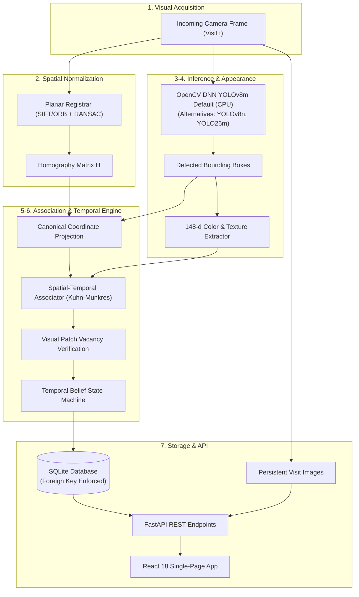

# ObjectMemory: Long-Term Visual Memory for Detecting Persistent Environmental Changes

> An AI-based visual memory system that compares physical scenes over time to detect and explain persistent changes in object locations while filtering out temporary variations such as lighting, occlusion, and viewpoint changes.

[](https://www.python.org/downloads/)
[](https://fastapi.tiangolo.com/)
[](https://react.dev/)
[]()
[](LICENSE)

---

## 1. System Overview

**ObjectMemory** bridges the gap between memoryless per-frame object detection and long-term environmental persistence for robotics, electronics workbenches, and automated laboratory monitoring.

Standard deep detectors operate frame-by-frame: a temporary occlusion or shadow is often misclassified as an object removal, while a relocated object returning to its original coordinate is mistaken for a new entity. ObjectMemory resolves these issues by implementing a seven-stage pipeline:

1. **Epistemic State Tracking**: Decouples transient visual detections (`Observation`) from long-term persistent state (`WorkbenchEntity`), maintaining explicit belief states: `CONFIRMED_PRESENT`, `CONFIRMED_MOVED`, `PENDING_REMOVAL`, `CONFIRMED_REMOVED`, `INSUFFICIENT_EVIDENCE`, and `AMBIGUOUS_IDENTITY`.
2. **Planar Homography Co-Registration**: Normalizes camera viewpoint variations using SIFT/ORB features and RANSAC homography estimation ($p_{\text{ref}} \sim H p_{\text{query}}$) with strict geometric distortion gating.
3. **CPU-Friendly Object Detection**: Uses pretrained Ultralytics **YOLOv8 Medium ONNX** (`models/yolov8m.onnx`, ~99.0 MB) as the production default detector strictly on CPU via OpenCV DNN, with **YOLOv8 Nano** (`models/yolov8n.onnx`, ~12.2 MB) and **YOLO26 Medium** (`models/yolo26m.onnx`, ~78.1 MB via ONNX Runtime) supported as selectable alternatives.
4. **Spatial-Temporal Association**: Employs Kuhn-Munkres optimal bipartite matching with displacement gating, appearance similarity, and ambiguity margins to prevent false identity swaps.
5. **Multi-Visit Vacancy Verification**: Enforces a multi-visit absence streak ($\ge 2$ consecutive visits) combined with visual patch vacancy verification to suppress false removal alarms.
6. **Auditable Change Ledger**: Commits all transitions to an ACID-compliant SQLite store with explainable natural-language rationales and historical coordinates.

### Implemented vs. Experimentally Validated Scope
- **Implemented System Capabilities**: Full 7-stage backend pipeline, `DetectorRegistry` (`yolov8m` default, `yolov8n`, `yolo26m`, `mock`), isolated per-workspace SQLite persistence, FastAPI REST backend, React 18 SPA supporting single/batch/webcam ingest, visit comparison, timeline/entity inspection, and a supplementary **ETH Registration** tab (`/api/eth-lounge/*`) for 2D planar registration testing on ETH ASL Lounge frames.
- **Experimentally Validated Scope**: Evaluated on controlled tabletop benchmarks (Synthetic Workbench v2 and 6-scenario / 30-observation Physical Pilot v2) with supplementary planar registration evaluation on ETH ASL Lounge (10 sessions). Results from the small physical pilot reflect controlled tabletop conditions and do not establish general-world or unconstrained 3D environment accuracy.

---

## 2. Architecture & Data Flow



---

## 3. Experimental Evaluation & Results

ObjectMemory was evaluated across three core dataset configurations using the standardized **Benchmark Evaluation Harness**:

1. **Physical Pilot v2 (`data/physical_pilot_v2/manifest_v2.json`) — Primary Evaluation**: 30 photographs across 6 controlled tabletop scenarios (`stationary`, `movement`, `removal`, `addition`, `occlusion`, `return_to_baseline`), 183 entity-visit annotations (177 visible ground-truth instances) across 7 object classes.
2. **Synthetic Workbench v2 (`data/synthetic_workbench_v2/`) — Supplementary Controlled Evaluation**: 25 procedurally generated images across 5 controlled sequences (`S01`–`S05`), used for controlled vacancy (A2*) and association ambiguity (A5) experiments.
3. **ETH ASL Lounge — Supplementary Registration Evaluation**: 10 sessions used for supplementary planar image-registration evaluation, demonstrating registration limitations under viewpoint changes and 3D parallax.

### 3.1 Physical Pilot v2 Results (6 Scenarios, 30 Observations, 183 Evaluations)

| Configuration | Detector / Input | State Accuracy | Detection Recall | Identity Consistency | False Removal Rate |
| :--- | :--- | :---: | :---: | :---: | :---: |
| **B3 (YOLOv8n)** | `yolov8n.onnx` | 30.60% (56/183) | 27.12% (48/177) | 26.82% (48/179) | 3.33% (6/180) |
| **B3 (YOLOv8m — Production Default)** | `yolov8m.onnx` | **89.07% (163/183)** | **90.40% (160/177)** | **89.39% (160/179)** | **0.56% (1/180)** |
| **B3 (YOLO26m — Comparison Model)** | `yolo26m.onnx` | **90.71% (166/183)** | **90.96% (161/177)** | **88.27% (158/179)** | **1.67% (3/180)** |
| **Track B Oracle (Corrected)** | Ground-Truth Boxes | **96.17% (176/183)** | 100.00% (Oracle) | 100.00% (Oracle) | 0.00% (0/180) |

- **Oracle Evaluation Correction**: The historical Track B Oracle run reported 76.50% (140/183) because `evaluate_sequence_entity_level` in `scripts/evaluate_physical_workbench.py` checked only `visit_reports[1].entity_updates` for Visit 1 states, scoring all 36 baseline entities (instantiated directly in `SQLiteMemoryStore` as `CONFIRMED_PRESENT` without transition updates) as `INSUFFICIENT_EVIDENCE`. Retrieving Visit 1 baseline states directly from the store yields **96.17% (176/183)** without changing the temporal engine.
- **Bottleneck & Removal Recall Note**: In YOLOv8m B3, `bottle` (a clear glass tumbler on a reflective tabletop) had **46.15% recall (12/26)** and was missed in Visit 1 of `stationary`, `movement`, and `removal`. Because `bottle_01` was never instantiated in the `removal` sequence, YOLOv8m B3 recorded **0/3 visit removal recall** (`0/1` event removal recall), whereas `Track B Oracle` confirmed the temporal removal logic when given ground-truth boxes.

### 3.2 Synthetic v2 & Desk Pilot Benchmark Matrix (YOLOv8n Baseline Harness)

| Dataset | Config | Description | Detection F1 | False Removal Rate | Removal Recall (Visits) | Removal Recall (Events) | Confirmation Rate | Identity Consist. | State Acc. |
| :--- | :--- | :--- | :---: | :---: | :---: | :---: | :---: | :---: | :---: |
| **Synthetic v2** (25 obs) | **B0** | Raw Detector Baseline | **0.987** | *N/A* | *N/A* | *N/A* | *N/A* | *N/A* | 0.904 |
| | **B3** | Complete ObjectMemory | *N/A* | **0.00%** (0/121) | **100%** (4/4) | **100%** (2/2) | **100%** (4/4) | **97.46%** (115/118) | **0.944** |
| | **A2\*** | No Vacancy Verification | *N/A* | 0.00% (0/121) | 100% (4/4) | 100% (2/2) | 100% (4/4) | 97.46% (115/118) | **0.928** |
| **Desk Pilot** (7 obs) | **B0** | Raw Detector Baseline | 0.698 | *N/A* | *N/A* | *N/A* | *N/A* | *N/A* | 0.714 |
| | **B3** | Complete ObjectMemory | *N/A* | **0.00%** (0/38) | 0.00% (0/4) | 0.00% (0/3) | 20.0% (1/5) | **88.24%** (30/34) | **0.738** |

*\* Denotes partial configuration due to engine fallback logic. Detailed analysis in `research_validation/synthetic_public_dataset_evaluation_report.md` and `research_validation/larger_detector_experiment/YOLOV8M_INTEGRATION_REPORT.md`.*

---

## 4. Quick Start & Demonstration

See [DEMO_GUIDE.md](DEMO_GUIDE.md) for complete setup, interactive walkthrough, and troubleshooting instructions.

### 4.1 Prerequisites & Installation
- Python 3.11+ (tested on Python 3.11.9).
- Node.js 18+ (only required if modifying and rebuilding the frontend).

```powershell
git clone https://github.com/Rish244-afk/ObjectMemory.git
cd ObjectMemory
pip install -r requirements.txt
```

**Model Setup (`yolov8m.onnx`):** `models/yolov8n.onnx` (12.2 MB) is included directly in the repository. Because `models/yolov8m.onnx` (~99.0 MB) approaches GitHub's 100 MB file limit, generate it from official Ultralytics weights (see [models/README.md](models/README.md) for checksums):
```powershell
pip install ultralytics onnx
python -c "from ultralytics import YOLO; YOLO('yolov8m.pt').export(format='onnx', imgsz=640, simplify=True)"
Move-Item yolov8m.onnx models/yolov8m.onnx -Force
```

**Technology Stack:** Python 3.11, OpenCV DNN (CPU ONNX), NumPy, SciPy (`linear_sum_assignment`), SQLite3, FastAPI, Uvicorn, React 18, TypeScript, Vite, and Tailwind CSS.

### 4.2 Interactive Full-Stack Application
From the repository root (ensuring `src` is on `PYTHONPATH`):
```powershell
cd C:\Users\Rishh\.gemini\antigravity\scratch\objectmemory
$env:PYTHONPATH = "src"
python -m uvicorn objectmemory.api.app:app --host 127.0.0.1 --port 8000
```
*(After a fresh `git clone`, run the same `uvicorn` command from your cloned `ObjectMemory` directory, and run `cd frontend; npm install; npm run build` if `frontend/dist/` has not been built yet.)*
- Web Application: [http://127.0.0.1:8000/](http://127.0.0.1:8000/)
- REST API Documentation: [http://127.0.0.1:8000/docs](http://127.0.0.1:8000/docs)
- Health Check: [http://127.0.0.1:8000/api/health](http://127.0.0.1:8000/api/health)

### 4.3 Automated Backend Demonstration
```powershell
python scripts/run_final_demonstration.py
```
Output log is saved to `research_validation/results/demo_execution_log.json`.

### 4.4 Running Automated Tests
```powershell
python -m pytest -o pythonpath=src
```
*Last verified suite run: 427 passed, 1 skipped, 0 failed.*

---

## 5. Repository Structure

```
objectmemory/
├── DEMO_GUIDE.md                  # Reproducible setup and walkthrough guide
├── FINAL_PROJECT_REPORT.md        # Complete final academic project report
├── data/
│   ├── physical_pilot_v2/         # 6-scenario, 30-image physical pilot & manifest_v2.json
│   ├── synthetic_workbench_v2/    # 25 generated benchmark images & manifest v2.0
│   ├── real_workbench/            # 7 genuine physical desk images & manifest
│   └── workspaces/                # SQLite databases & persistent workspace sessions
├── docs/                          # Phase design notes, architecture & protocol docs
├── frontend/                      # React 18 + TypeScript + Vite web interface
│   ├── src/                       # Components, views, API client
│   └── dist/                      # Built production SPA static assets
├── models/
│   ├── yolov8m.onnx               # Pretrained YOLOv8 medium ONNX (99.0 MB, default)
│   ├── yolov8n.onnx               # Pretrained YOLOv8 nano ONNX (12.2 MB, alternative)
│   └── yolo26m.onnx               # YOLO26 medium ONNX (78.1 MB, alternative / comparison)
├── research_validation/
│   ├── larger_detector_experiment/
│   │   └── YOLOV8M_INTEGRATION_REPORT.md
│   ├── poster/                    # Academic poster deliverables (A0 PPTX, PDF, Preview PNG)
│   └── ...                        # Benchmark result JSONs and audit reports
├── scripts/                       # Evaluation, dataset, and demo scripts
├── src/objectmemory/
│   ├── api/                       # FastAPI router, schemas, WorkspaceManager
│   ├── benchmarks/                # ManifestLoader, ConfigFactory, BenchmarkRunner
│   ├── detection/                 # DetectorRegistry, OpenCVDNNDetector
│   ├── persistence/               # SQLiteMemoryStore, models, schema migrations
│   ├── registration/              # PlanarRegistrar (SIFT/ORB) & quality gating
│   └── temporal/                  # Associator, TemporalMemoryEngine, epistemic states
└── tests/                         # 401 automated unit & integration tests
```

---

## 6. Technical Limitations & Scope

- **Dominant Plane Assumption**: Relies on 2D planar homography ($H \in \mathbb{R}^{3 \times 3}$). Designed for tabletops and workbenches; unconstrained 3D multi-room camera translations with large depth parallax (demonstrated on ETH ASL Lounge) cause registration degradation.
- **Transparent & Specular Object Recall**: On `physical_pilot_v2`, pretrained COCO `yolov8m` achieved 90.40% overall recall, but only 46.15% (12/26) on the clear glass tumbler (`bottle`), preventing instantiation in 3 of 6 sequences and yielding 0/3 visit removal recall in B3.
- **Small Pilot Sample Size**: The 6-sequence, 30-observation physical pilot demonstrates tabletop feasibility under controlled indoor conditions and does not establish general-world accuracy.
- **CPU Inference Latency**: `yolov8m` averages ~619 ms/frame on CPU vs ~28 ms/frame for `yolov8n`, suited for episodic visit monitoring rather than 30 FPS video streaming.
- **Handcrafted Appearance Model**: Uses 148-d HSV histograms and Sobel gradient descriptors optimized for low-latency CPU inference without GPU acceleration.

---

## 7. Citation & Academic Reference

For full technical and academic documentation, refer to:
- Final Project Report: [FINAL_PROJECT_REPORT.md](FINAL_PROJECT_REPORT.md)
- Academic Research Poster: [research_validation/poster/ObjectMemory_Poster.pptx](research_validation/poster/ObjectMemory_Poster.pptx) | [PDF](research_validation/poster/ObjectMemory_Poster.pdf) | [Preview](research_validation/poster/ObjectMemory_Poster_Preview.png)
- Final Project Stabilization Report: [research_validation/FINAL_PROJECT_STABILIZATION_REPORT.md](research_validation/FINAL_PROJECT_STABILIZATION_REPORT.md)
- YOLOv8m Integration & Oracle Audit: [research_validation/larger_detector_experiment/YOLOV8M_INTEGRATION_REPORT.md](research_validation/larger_detector_experiment/YOLOV8M_INTEGRATION_REPORT.md)
- YOLO26m Implementation & Live Evaluation: [research_validation/YOLO26M_IMPLEMENTATION_AND_LIVE_EVALUATION_REPORT.md](research_validation/YOLO26M_IMPLEMENTATION_AND_LIVE_EVALUATION_REPORT.md)
- Dataset Guide: [data/README.md](data/README.md) | Model Guide: [models/README.md](models/README.md)
- Demonstration Guide: [DEMO_GUIDE.md](DEMO_GUIDE.md)
