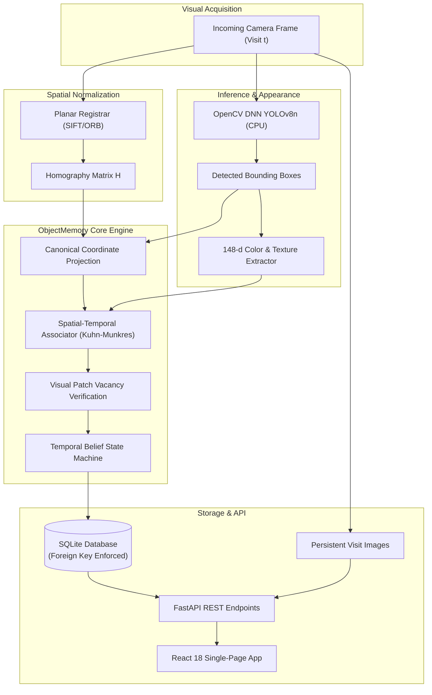

# ObjectMemory: Long-Term Visual Memory for Detecting Persistent Environmental Changes

> An AI-based visual memory system that compares physical scenes over time to detect and explain persistent changes in object locations while filtering out temporary variations such as lighting, occlusion, and viewpoint changes.

[](https://www.python.org/downloads/)
[](https://fastapi.tiangolo.com/)
[](https://react.dev/)
[]()
[](LICENSE)

---

## 1. System Overview

**ObjectMemory** bridges the gap between memoryless per-frame object detection and long-term environmental persistence for robotics, electronics workbenches, and automated laboratory monitoring.

Standard deep detectors operate frame-by-frame: a temporary occlusion or shadow is often misclassified as an object removal, while a relocated object returning to its original coordinate is mistaken for a new entity. ObjectMemory resolves these issues by implementing:

1. **Epistemic State Tracking**: Decouples transient visual detections (`Observation`) from long-term persistent state (`WorkbenchEntity`), maintaining explicit belief states: `CONFIRMED_PRESENT`, `CONFIRMED_MOVED`, `PENDING_REMOVAL`, `CONFIRMED_REMOVED`, and `INSUFFICIENT_EVIDENCE`.
2. **Planar Homography Co-Registration**: Normalizes camera viewpoint variations using SIFT/ORB features and RANSAC homography estimation ($p_{\text{ref}} \sim H p_{\text{query}}$) with strict geometric distortion gating.
3. **CPU-Friendly Object Detection**: Runs Ultralytics YOLOv8 nano ONNX (`models/yolov8n.onnx`, 12.2 MB) strictly on CPU via OpenCV DNN with zero GPU requirement.
4. **Spatial-Temporal Association**: Employs Kuhn-Munkres optimal bipartite matching with displacement gating and ambiguity margins to prevent false identity swaps.
5. **Multi-Visit Vacancy Verification**: Enforces a multi-visit absence streak combined with visual patch vacancy verification to eliminate false removal alarms.
6. **Auditable Change Ledger**: Commits all transitions to an ACID-compliant SQLite store with explainable natural-language rationales and historical coordinates.

---

## 2. Architecture & Data Flow



---

## 3. Experimental Evaluation & Results

The framework was evaluated across three distinct datasets using the standardized **Benchmark Evaluation Harness (v2.0)**:
- **Synthetic Workbench v2 (`data/synthetic_workbench_v2/`)**: 25 observations across 5 controlled sequences (`S01` stationary, `S02` relocation, `S03` removal, `S04` occlusion, `S05` lighting/viewpoint perturbations) generated using segmented photographic cutouts on procedural wood grain with contact shadows and ArUco fiducials.
- **Genuine Physical Desk Pilot (`data/real_workbench/`)**: 7 sequential real smartphone images of an office desk.
- **OpenLORIS-Scene (`office1-1`)**: 10 keyframes from an Intel RealSense D435i camera on an automated guided vehicle (AGV) traversing an indoor office with OptiTrack 6-DOF ground-truth poses. Evaluated strictly to test the geometric failure boundary of 2D planar homography under 3D depth parallax (8/9 transitions collapsed into singular homographies; only 1 near-static transition succeeded). The dataset lacks native object lifecycle annotations; all temporal metrics are unscorable (`N/A`), and it is explicitly not framed as successful object-memory validation.

### Benchmark Matrix

| Dataset | Config | Description | Detection F1 | False Removal Rate | False Discovery Prop. | Removal Recall (Visits) | Removal Recall (Events) | Confirmation Rate | Identity Consist. | Frag. | State Acc. |
| :--- | :--- | :--- | :---: | :---: | :---: | :---: | :---: | :---: | :---: | :---: | :---: |
| **Synthetic v2** (25 obs) | **B0** | Raw Detector Baseline | **0.987** | *N/A* | *N/A* | *N/A* | *N/A* | *N/A* | *N/A* | 0 | 0.904 |
| | **B3** | Complete ObjectMemory | *N/A* | **0.00%** (0/121) | **0.00%** (0/4) | **100%** (4/4) | **100%** (2/2) | **100%** (4/4) | **97.46%** (115/118) | **0** | **0.944** |
| | **A5** | No Ambiguity Margin | *N/A* | 0.00% (0/121) | 0.00% (0/4) | 100% (4/4) | 100% (2/2) | 100% (4/4) | 97.46% (115/118) | 0 | 0.944 |
| | **A2\*** | No Vacancy Verification | *N/A* | 0.00% (0/121) | 0.00% (0/4) | 100% (4/4) | 100% (2/2) | 100% (4/4) | 97.46% (115/118) | 0 | **0.928** |
| | **A3\*** | No FOV Safeguards | *N/A* | 0.00% (0/121) | 0.00% (0/4) | 100% (4/4) | 100% (2/2) | 100% (4/4) | 97.46% (115/118) | 0 | 0.944 |
| **Desk Pilot** (7 obs) | **B0** | Raw Detector Baseline | 0.698 | *N/A* | *N/A* | *N/A* | *N/A* | *N/A* | *N/A* | 0 | 0.714 |
| | **B3** | Complete ObjectMemory | *N/A* | **0.00%** (0/38) | *N/A* | 0.00% (0/4) | 0.00% (0/3) | 20.0% (1/5) | **88.24%** (30/34) | **0** | **0.738** |

*\* Denotes partial configuration due to engine fallback logic. Detailed analysis in `research_validation/synthetic_public_dataset_evaluation_report.md`.*

**Metric Denominators & Eligibility:**
- **Removal Recall (Visits vs Events)**: Synthetic v2 confirmed 4/4 visits (100%) and 2/2 unique removal events (100%). Desk Pilot confirmed 0/4 visits (0%) and 0/3 events (0%) because the 7-visit pilot concluded before unobserved streak thresholds (>= 2 visits) were satisfied.
- **Confirmation Rate**: Synthetic v2 confirmed 4/4 eligible changes (100%). Desk Pilot confirmed 1/5 eligible changes (20%) [cup move confirmed; 1 micro-move and 3 removals unconfirmed].
- **B0 Baseline**: Memoryless single-frame detection baseline. Evaluates raw per-frame detection metrics (Synthetic v2: P=1.00, R=0.975, F1=0.987; Desk Pilot: P=0.577 [30/52], R=0.882 [30/34], F1=0.698 [60/86]). Temporal change metrics are undefined for memoryless models and reported as `N/A`.

---

## 4. Quick Start & Demonstration

### 4.1 Prerequisites
- Python 3.10+ (tested on Python 3.11).
- Node.js 18+ (only if rebuilding frontend).

### 4.2 Automated Backend Demonstration
Run the end-to-end demonstration script exercising all 7 core backend capabilities (scene ingestion, stationary stability, relocation, removal confirmation, occlusion recovery, history retrieval, and registration failure handling):
```bash
python scripts/run_final_demonstration.py
```
Output log is saved to `research_validation/results/demo_execution_log.json`.

> [!NOTE]
> The demonstration script exercises the backend pipeline algorithms, data structures, and SQLite state machine programmatically. The web application frontend and FastAPI endpoints were validated via server health checks (`/api/health`) and static build compilation (`tsc -b && vite build`). Programmatic browser DOM automation was not run; full interactive UI verification requires manual browser walkthrough following `docs/DEMONSTRATION_INSTRUCTIONS.md`.

### 4.3 Interactive Full-Stack Application
Start the FastAPI server (which mounts the pre-built React SPA):
```bash
uvicorn objectmemory.api.app:app --host 0.0.0.0 --port 8000 --reload
```
- Web Application: [http://localhost:8000/](http://localhost:8000/)
- REST API Documentation: [http://localhost:8000/docs](http://localhost:8000/docs)
- Health Check: [http://localhost:8000/api/health](http://localhost:8000/api/health)

### 4.4 Running Automated Tests
Run the entire regression and integration test suite:
```bash
python -m unittest discover -s tests -p "test_*.py"
```
*Current test status: 401 tests ran, 400 passed, 1 skipped, 0 failures, 0 errors.*

### 4.5 Reproducing Benchmark Evaluations
Execute the evaluation matrix on the Synthetic Workbench v2:
```bash
python scripts/evaluate_synthetic_workbench_v2.py
```

---

## 5. Repository Structure

```
objectmemory/
├── data/
│   ├── synthetic_workbench_v2/    # 25 generated benchmark images & manifest v2.0
│   ├── real_workbench/            # 7 genuine physical desk images & manifest v2.0
│   └── workspaces/                # SQLite databases & persistent workspace sessions
├── docs/
│   ├── ARCHITECTURE.md            # Detailed system architecture & data contracts
│   ├── DEMONSTRATION_INSTRUCTIONS.md # Step-by-step demonstration walkthrough
│   ├── EXPERIMENTAL_METHODOLOGY_AND_RESULTS.md # Detailed experimental findings
│   └── LIMITATIONS_AND_FUTURE_WORK.md # Technical boundaries & research roadmap
├── frontend/                      # React 18 + TypeScript + Vite web interface
│   ├── src/                       # Components, views, API client
│   └── dist/                      # Built production SPA static assets
├── models/
│   └── yolov8n.onnx               # Pretrained YOLOv8 nano ONNX model (12.2 MB)
├── research_validation/
│   ├── FINAL_DELIVERY_REPORT.md   # Final delivery audit & verification report
│   ├── final_year_project_report.md # Academic thesis & technical report
│   ├── research_paper_draft.md    # Conference paper draft (IEEE/CVPR format)
│   ├── final_presentation_structure.md # Slide deck presentation outline
│   └── results/benchmarks/        # 13 serialized benchmark run JSON results
├── scripts/
│   ├── generate_synthetic_workbench_v2.py # Synthetic dataset procedural compositor
│   ├── evaluate_synthetic_workbench_v2.py # Benchmark matrix evaluator
│   └── run_final_demonstration.py # End-to-end automated demonstration
├── src/objectmemory/
│   ├── api/                       # FastAPI router, schemas, WorkspaceManager
│   ├── benchmarks/                # ManifestLoader, ConfigFactory, BenchmarkRunner
│   ├── detection/                 # OpenCV DNN detector & visual signature extractor
│   ├── persistence/               # SQLite store, models, schema migrations
│   ├── registration/              # Planar registrar (SIFT/ORB) & quality gating
│   └── temporal/                  # Associator, engine, and epistemic state machine
└── tests/                         # 401 automated unit & integration tests
```

---

## 6. Technical Limitations & Scope

- **Dominant Plane Assumption**: Relies on 2D planar homography ($H \in \mathbb{R}^{3 \times 3}$). Designed for tabletops, workbenches, and planar surfaces; unconstrained 3D multi-room camera translations with large depth parallax (demonstrated in OpenLORIS-Scene) cause registration failure.
- **Detector Upper Bound**: When raw object detection repeatedly fails past the streak threshold ($\ge 3$ visits), temporal reasoning cannot maintain the entity indefinitely.
- **Handcrafted Appearance Model**: Uses 148-d HSV histograms and Sobel gradient descriptors optimized for low-latency CPU inference without GPU acceleration.

---

## 7. Citation & Academic Reference

If using ObjectMemory in academic research or technical projects, please refer to:
- Technical Report: `research_validation/final_year_project_report.md`
- Paper Draft: `research_validation/research_paper_draft.md`
- Implementation: `src/objectmemory/`
