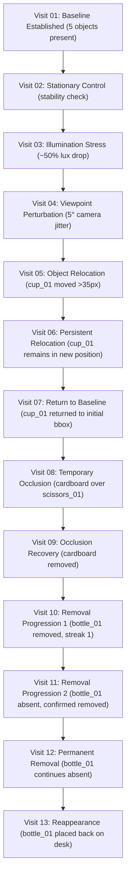

# Physical Workbench Benchmark v1: Photographic Data Capture Protocol

**ObjectMemory Studio — Phase 15 Empirical Validation Protocol**  
**Dataset Path:** `data/physical_workbench_v1/`  
**Manifest:** `data/physical_workbench_v1/manifest.json`  
**Current Status:** `AWAITING_PHYSICAL_DATA`

---

## 1. Overview & Scientific Purpose

This protocol specifies the physical setup, sensor calibration, target object placement, and capture steps for generating the controlled photographic benchmark for ObjectMemory.

Unlike single-frame object detection benchmarks (COCO, Pascal VOC) or short-term high-frame-rate tracking benchmarks (MOT17, MOT20), ObjectMemory evaluates **long-term visual memory across disparate observation sessions** separated by arbitrary time intervals. The goal is to detect and explain true physical relocations, return-to-baseline events, and removals while maintaining strict invariance to:
1. Illumination variations (shadows, lux drops, directional lamps).
2. Moderate camera viewpoint perturbations (pan, tilt, and height jitter).
3. Temporary visual occlusions.

---

## 2. Workbench Environment & Rig Specification

### 2.1 Physical Workbench
- **Surface:** Flat, rigid table or desk (minimum active area: 80 cm × 60 cm).
- **Surface Texture:** Neutral wood, laminate, or matte solid-color desk pad to minimize specular reflections.
- **Environment:** Indoor room with controllable ambient overhead lighting and an optional directional desk lamp.

### 2.2 Calibration Fiducials (ArUco Planar Reference Frame)
- **Dictionary:** ArUco `DICT_4X4_50`.
- **Marker Size:** 50 mm × 50 mm (printed on non-glossy white cardstock).
- **Placement:** Affixed rigidly at the four perimeter corners of the active workbench area:
  - `ID 0`: Top-Left corner `(X_min, Y_min)`
  - `ID 1`: Top-Right corner `(X_max, Y_min)`
  - `ID 2`: Bottom-Right corner `(X_max, Y_max)`
  - `ID 3`: Bottom-Left corner `(X_min, Y_max)`
- **Role:** Establishes the ground-truth metric plane for homography estimation (`H_canonical`), enabling sub-pixel reprojection error measurement and decoupling perspective distortion from object movement.

### 2.3 Camera & Sensor Configuration
- **Mounting:** Rigid tripod or boom arm positioned facing the workbench at an oblique downward angle of **45° to 60°** relative to the horizontal table plane.
- **Sensor Resolution:** Native 1920 × 1080 (1080p) or higher, captured uncompressed or high-quality JPEG/PNG (quality >= 95).
- **Optical Settings (Strict Manual Lock):**
  - **Exposure Time & Aperture:** Locked manually to avoid auto-exposure hunting during minor lighting shifts.
  - **ISO:** Fixed (e.g., ISO 100 or 200).
  - **White Balance:** Fixed manually (e.g., 5000K daylight or fluorescent lock).
  - **Focus:** Manual focus locked onto the center of the workbench surface; auto-focus must be disabled.

---

## 3. Target Objects Specification

| Object ID | COCO / YOLO Class | Physical Item Description | Nominal Size (cm) | Visual Features |
|---|---|---|---|---|
| `cup_01` | `cup` | Ceramic coffee mug with handle | 9 × 11 × 8 | Solid white, distinct handle orientation |
| `book_01` | `book` | Paperback publication | 13 × 20 × 2 | Navy/dark cover with text |
| `scissors_01` | `scissors` | Metal craft scissors | 8 × 18 × 1.5 | Red plastic handles, metallic blades |
| `bottle_01` | `bottle` | Reusable water bottle | 7 × 7 × 24 | Translucent blue/clear with screw cap |
| `phone_01` | `cell phone` | Smartphone in protective cover | 7.5 × 15 × 0.8 | Dark rectangle, flat on table |

---

## 4. Comprehensive 13-Visit Lifecycle Protocol (`EXP01_comprehensive_workbench`)

The comprehensive experiment sequence exercises all eight canonical state transitions in a single continuous timeline:



### Detailed Visit Step-by-Step Instructions

1. **Visit 01 (`EXP01_comprehensive_workbench_visit_01.jpg`): Baseline Establishment**
   - Place all 5 target objects inside the ArUco boundary area at clearly separated positions (minimum 10 cm separation).
   - Ensure nominal ambient overhead lighting (~400–500 lux).
   - Capture photograph. All 5 objects are ground-truth `CONFIRMED_PRESENT`.

2. **Visit 02 (`EXP01_comprehensive_workbench_visit_02.jpg`): Stationary Stability Control**
   - Do not touch any object or camera rig.
   - Capture photograph. Verify zero false movement alerts and zero identity drift.

3. **Visit 03 (`EXP01_comprehensive_workbench_visit_03.jpg`): Illumination Stress**
   - Keep all objects stationary. Dim overhead room light by ~50% or cast an oblique shadow across half the desk.
   - Capture photograph. All objects must remain `CONFIRMED_PRESENT`.

4. **Visit 04 (`EXP01_comprehensive_workbench_visit_04.jpg`): Viewpoint Perturbation**
   - Keep all objects stationary. Restore nominal lighting.
   - Slightly pan or tilt the camera tripod by **3°–5°** or raise the column by ~5 cm.
   - Capture photograph. Planar homography should register ArUco corners with reprojection error < 2.0 px; objects remain `CONFIRMED_PRESENT`.

5. **Visit 05 (`EXP01_comprehensive_workbench_visit_05.jpg`): Object Relocation**
   - Return camera to nominal pose.
   - Pick up `cup_01` and move it **15 cm to the right** (displacement > 35 px in canonical space).
   - Capture photograph. `cup_01` transitions to `CONFIRMED_MOVED`; vacancy check at baseline location confirms previous spot is vacant.

6. **Visit 06 (`EXP01_comprehensive_workbench_visit_06.jpg`): Persistent Relocation**
   - Leave `cup_01` in the new relocated position. Leave all other objects undisturbed.
   - Capture photograph. `cup_01` maintains `CONFIRMED_MOVED` without track fragmenting.

7. **Visit 07 (`EXP01_comprehensive_workbench_visit_07.jpg`): Return to Baseline**
   - Pick up `cup_01` and place it back onto its original marked baseline position from Visit 01 (within 20 px).
   - Capture photograph. `cup_01` transitions back to `CONFIRMED_PRESENT` with `return_to_baseline` event.

8. **Visit 08 (`EXP01_comprehensive_workbench_visit_08.jpg`): Temporary Occlusion**
   - Place a piece of opaque gray cardboard over `scissors_01`, covering approximately 50%–70% of the object.
   - Capture photograph. `scissors_01` transitions to `PARTIALLY_OCCLUDED` (or `PENDING_REMOVAL` under streak 1); removal must NOT be confirmed.

9. **Visit 09 (`EXP01_comprehensive_workbench_visit_09.jpg`): Occlusion Recovery**
   - Remove the cardboard occluder completely, leaving `scissors_01` fully visible at its original location.
   - Capture photograph. `scissors_01` restores immediately to `CONFIRMED_PRESENT`.

10. **Visit 10 (`EXP01_comprehensive_workbench_visit_10.jpg`): Removal Progression (Streak 1)**
    - Physically remove `bottle_01` completely from the room/workbench area.
    - Capture photograph. `bottle_01` is absent (streak 1). State is `PENDING_REMOVAL`.

11. **Visit 11 (`EXP01_comprehensive_workbench_visit_11.jpg`): Removal Confirmation (Streak 2)**
    - Do not alter scene. `bottle_01` remains absent.
    - Capture photograph. `bottle_01` reaches streak 2 and vacancy check succeeds -> confirmed state transition to `CONFIRMED_REMOVED`.

12. **Visit 12 (`EXP01_comprehensive_workbench_visit_12.jpg`): Continued Absence Verification**
    - Scene remains without `bottle_01`.
    - Capture photograph. State remains `CONFIRMED_REMOVED`.

13. **Visit 13 (`EXP01_comprehensive_workbench_visit_13.jpg`): Reappearance after Removal**
    - Return `bottle_01` to the workbench surface.
    - Capture photograph. Temporal engine associates detection with the previously removed `bottle_01` entity, restoring it to `CONFIRMED_PRESENT` with a `reappearance` event.

---

## 5. Automated Capture Script

The repository includes a dedicated CLI capture assistant:
```powershell
python scripts/capture_workbench_sequence.py --sequence-id EXP01_comprehensive_workbench --camera 0
```
This tool:
- Opens a live video feed from camera device index 0.
- Real-time detects the 4 ArUco markers and displays homography calibration quality.
- Prompts the user with the expected action for each visit (1 through 13).
- Saves captured frames directly into `data/physical_workbench_v1/images/` with correct filenames.

---

## 6. Scientific Integrity Safeguards

1. **No Synthetic Fabrication:** Synthetic bounding boxes or hallucinated pixels must never be inserted into `data/physical_workbench_v1/`. The dataset status remains `AWAITING_PHYSICAL_DATA` until genuine photos are loaded.
2. **Explicit Uncertainty:** If an image has poor lighting or camera blur causing ArUco reprojection error > 5.0 px, the registration gate halts state evolution and records `INSUFFICIENT_EVIDENCE`.
3. **Reproducibility:** All physical object names, dimensions, and visit sequences are version-controlled in `manifest.json`.
