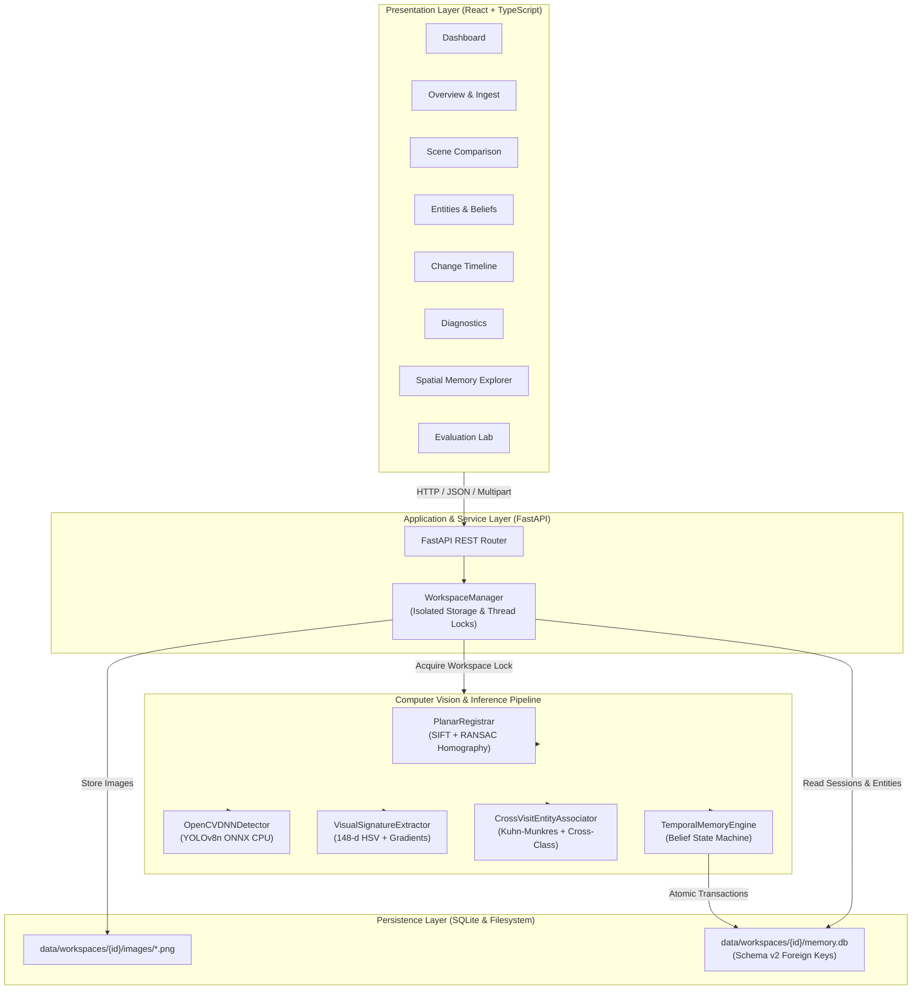
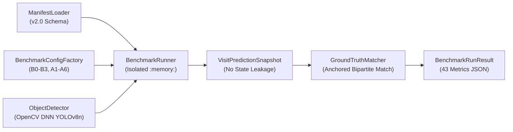

# ObjectMemory: System Architecture

## 1. Architectural Philosophy

ObjectMemory is designed around the core principle that **transient observations must be strictly decoupled from persistent environmental state**:

1. **Observations are Local and Ephemeral:** A single visit image produces detections with raw bounding boxes in camera image coordinates $(x, y)$, confidence scores, and visual signatures. A missed detection or an occluded view is an observation phenomenon, not an environmental fact.
2. **Beliefs are Persistent and Historical:** The system maintains persistent beliefs (`EpistemicState`) about physical entities across repeated visits. State transitions require corroborating evidence over multiple visits.
3. **Decoupled Spatial Coordinate Frames:** Raw camera coordinates are mapped into a canonical reference space via planar homography ($p_{ref} \sim H \cdot p_{query}$). When registration quality is insufficient, spatial comparisons are strictly withheld.
4. **Traceable Explanations:** Every state transition is recorded as an immutable `ChangeEvent` with displacement distance, reason codes, and supporting evidence JSON.

---

## 2. High-Level Architecture Diagram



---

## 3. Detailed Data Flow

For every incoming physical visit frame:

1. **Ingest & Validation:**
   - Image bytes received via `POST /api/workspaces/{id}/observations`.
   - Validated: PNG/JPEG decoding check, minimum dimension $(32 \times 32)$ px, file size $\le 25$ MB.
   - Persisted safely to disk: `data/workspaces/{id}/images/visit_{idx}.png`.
   - ISO-8601 timestamp validated and normalized to UTC.
2. **Co-Registration:**
   - If visit is the first session, it is established as the canonical reference frame ($H = I_{3 \times 3}$).
   - If subsequent visit, `PlanarRegistrar` computes homography $H$ using SIFT keypoint matching.
   - Evaluated against quality gates: inlier ratio $\ge 20\%$, mean reprojection error $\le 4.0$ px, scale ratio $\in [0.15, 6.0]$.
3. **Object Detection:**
   - Pretrained YOLOv8n ONNX model runs CPU inference via OpenCV DNN.
   - Detections formatted with raw bounding boxes $[x_{min}, y_{min}, x_{max}, y_{max}]$ in image space.
4. **Canonical Projection & Signature Extraction:**
   - If registration succeeds, bounding boxes are projected via $H$ to canonical reference coordinates.
   - 148-d appearance signature is extracted from the pixel crop (96-d HSV histogram, 48-d Sobel gradients, 4-d aspect geometry).
5. **Entity Association:**
   - Matches current detections with active persistent entities using Kuhn-Munkres optimal assignment.
   - Cost matrix combines spatial IoU, centroid distance, and visual signature cosine similarity.
   - If classes mismatch but spatial overlap is high ($\text{IoU} \ge 0.35$, appearance similarity $\ge 0.70$), conservative cross-class association prevents duplicate entity creation.
6. **Temporal Belief Updating:**
   - Evaluates displacement relative to both initial position and last reliable position.
   - Coordinate drift rule: step displacement $\le 20$ px with $\text{IoU} \ge 0.35$ is attributed to registration drift.
   - Boundary clipping rule: objects within 8 px of image boundary require $\ge 100$ px displacement to confirm movement.
   - Removal progression: missing object requires consecutive verified vacant patches across 2 visits to reach `CONFIRMED_REMOVED`.
7. **Atomic SQLite Persistence:**
   - Observations, entities, and change events are committed within an atomic transaction.

---

## 4. Coordinate Spaces & Transformations

The system operates across two distinct 2D coordinate spaces:

```
[Camera Image Space: (x_img, y_img)]
         │
         │  Homography Mapping: p_ref ~ H @ p_query
         ▼
[Canonical Reference Space: (x_canon, y_canon)]
         │
         │  Coordinate Normalization: (x / W_ref, y / H_ref)
         ▼
[Spatial Memory Explorer: Virtual 2.5D Plane]
```

- **Camera Image Space:** Pixel coordinates $[0, W_{query}] \times [0, H_{query}]$ corresponding to the camera sensor.
- **Canonical Reference Space:** Standardized pixel coordinates $[0, W_{ref}] \times [0, H_{ref}]$ established by Visit 1.
- **Spatial Memory Coordinates:** Unit-interval normalized coordinates $[0, 1] \times [0, 1]$ used for responsive UI canvas rendering and virtual 2.5D spatial exploration.

---

## 5. Persistence, Threading & Workspace Isolation

- **Directory Partitioning:** Each physical workspace is completely isolated under:
  ```
  data/workspaces/{workspace_id}/
  ├── workspace.json      # Workspace metadata (slug, name, created_at, reference_session_id)
  ├── memory.db           # Dedicated SQLite database (Schema v2)
  └── images/             # Persistent visit images (visit_01.png, visit_02.png, ...)
  ```
- **Thread Safety:** Each workspace is protected by a dedicated `threading.RLock()`. In `SQLiteMemoryStore`, connections are configured with `check_same_thread=False` to allow FastAPI worker threads to execute sequential requests safely under the lock without thread collision.
- **Durability Across Restarts:** When the application or backend restarts, `WorkspaceManager` inspects `sessions` in `memory.db`, reads the image path of session 1 from disk, and restores `runner.ref_image`, preserving registration continuity.

---

## 6. Benchmark Evaluation Harness Architecture (v2.0)

To support reproducible empirical evaluation without compromising production behavior, the codebase includes a dedicated evaluation harness under `src/objectmemory/benchmarks/`:



1. **ManifestLoader (`manifest.py`)**:
   - Parses v2.0 JSON manifests containing multiple ordered sequences.
   - Enforces strict validation: non-empty `image_path`, monotonic ISO-8601 timestamps, valid coordinate bounds, and verified image files on disk.
2. **BenchmarkConfigFactory (`config_factory.py`)**:
   - Factory pattern constructing standardized configurations: B0 (raw detector reference), B3 (full engine), A5 (ambiguity ablation), and partial ablations A2 and A3.
   - Blocks unsupported configurations (B1, B2, A1, A4, A6) with explanatory error messages.
3. **BenchmarkRunner (`runner.py`)**:
   - Executes configurations in isolated temporary `:memory:` SQLite databases to eliminate cross-sequence state contamination.
   - Captures immutable per-visit prediction snapshots (`VisitPredictionSnapshot`) before advancing to subsequent visits, preventing historical state leakage.
   - Computes 43 granular metrics including False Removal Rate, Removal Recall (object-visits and independent events), Confirmation Rate, Identity Consistency, and State Accuracy.

