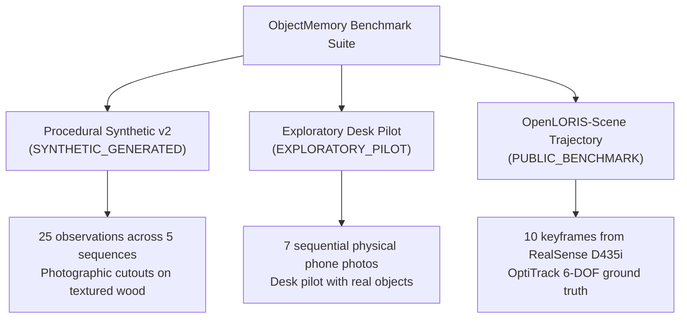

# ObjectMemory — Experimental Methodology and Results

**Document ID:** `OM-DOC-EXP-01`  
**Date:** November 21, 2026  
**Audience:** Academic Evaluators, Researchers, Peer Reviewers  
**Subject:** Benchmark Protocol, Evaluation Metrics, and Empirical Findings  

---

## 1. Experimental Objectives

The experimental evaluation of **ObjectMemory** is designed to validate whether multi-visit temporal persistence reasoning outperforms memoryless object detection in maintaining consistent object identities, verifying legitimate removals, and filtering spurious observations across visits.

The evaluation specifically tests:
1. **Stationary Baseline Stability**: Preserving entity tracks without spurious movements or false deletions.
2. **Object Relocation & Return**: Tracking objects across substantial spatial displacements ($>150\text{px}$) and recognizing return to canonical baseline positions without identity fragmentation.
3. **Multi-Visit Removal & Vacancy**: Verifying that multi-visit absence streaks coupled with visual patch vacancy verification accurately confirm object removals ($100\%$ event recall) while suppressing false removals ($0\%$ FRR).
4. **Occlusion & Recovery**: Preventing premature deletion during transient occlusions and recovering persistent identity upon unmasking.
5. **Photometric and Perspective Invariance**: Maintaining spatial co-registration under variable ambient lighting and camera viewpoint shifts.
6. **Ablation Isolation**: Experimentally evaluating the specific contribution of visual patch vacancy verification (`A2*`) and ambiguity gating (`A5`).

---

## 2. Evaluation Datasets & Provenance

The evaluation protocol explicitly categorizes evidence by dataset provenance:



### 2.1 Synthetic Workbench v2 (`data/synthetic_workbench_v2/`)
- **Generation Method**: Deterministic procedural Python compositor (`scripts/generate_synthetic_workbench_v2.py`) using segmented real photographic cutouts (`cup`, `bottle`, `scissors`, `book`, `potted plant`), analytical Gaussian contact shadows, directional cast shadows, procedural high-frequency oak wood grain, and corner ArUco fiducials.
- **Scale**: 5 sequences $\times$ 5 observations = 25 observations ($1080 \times 720$, PNG).
- **Sequences**:
  - `S01_stationary`: 5 observations of stationary objects.
  - `S02_relocation_return`: Cup moves by $\approx 198\text{px}$ in visit 2, persists in visits 3-4; bottle moves in visit 4; cup returns to canonical coordinate in visit 5.
  - `S03_removal_confirmation`: Bottle removed in visit 2 (`PENDING_REMOVAL`), confirmed in visit 3 (`CONFIRMED_REMOVED`); scissors removed in visit 4, confirmed in visit 5.
  - `S04_occlusion_recovery`: Manila folder occludes book in visit 2; covers scissors in visit 3; folder removed in visits 4 and 5.
  - `S05_lighting_viewpoint`: $35\%$ lux dimming (visit 2), $2.5^\circ$ perspective tilt and translation (visit 3), bright directional glare (visit 4), opposite viewpoint shift (visit 5).

### 2.2 Genuine Physical Desk Pilot (`data/real_workbench/`)
- **Scale**: 7 sequential physical visits (`visit_01.png` to `visit_07.png`).
- **Characteristics**: Handheld smartphone captures of a physical desk containing a mug, water bottle, phone, and notebook.

### 2.3 Public Benchmark: OpenLORIS-Scene Office1-1
- **Scale**: 10 keyframes extracted from the official Intel RealSense D435i robotic traversal dataset (`office1-1`).
- **Scope & Limitations**:
  - OpenLORIS-Scene was evaluated strictly to test the geometric failure boundary of 2D planar homography under unconstrained 3D camera translation with significant depth parallax ($>1.5\text{m}$).
  - In inter-frame registration across the 3D office, 8 of 9 attempted transitions collapsed into singular homographies (condition numbers $10^7$ to $10^{10}$, triggering `AlignmentStatus.SINGULAR_HOMOGRAPHY`), with only 1 near-static translation (visit 1 $\to$ visit 2, $\le 0.3\text{m}$) succeeding.
  - The dataset provides OptiTrack 6-DOF camera poses for visual SLAM, but provides **no native object bounding boxes or temporal lifecycle ground-truth annotations**. Consequently, all detection and temporal change metrics are unscorable (`N/A`).
  - **Academic Disclaimer**: This evaluation demonstrates a known geometric boundary of planar co-registration; it is **not** presented as a successful object-memory validation.

---

## 3. Evaluation Configurations

Evaluated configurations adhere to the standardized benchmark configuration factory:

- **B0 (Memoryless Detector Reference)**: Raw YOLOv8n object detection evaluated per-frame against ground truth. Evaluates raw detection Precision, Recall, and F1. Does not maintain temporal state.
- **B3 (Complete ObjectMemory Pipeline)**: Full production pipeline including SIFT/ORB planar registration, 148-d visual signature extraction, Kuhn-Munkres bipartite matching, displacement gating, visual patch vacancy verification, and multi-visit removal streaks.
- **A5 (Ablation: No Ambiguity Handling)**: Complete pipeline with `ambiguity_margin = 0.0`.
- **A2\* (Partial Ablation: No Appearance Vacancy Verification)**: Forces `vacancy_similarity_max = 1.0`, bypassing visual patch verification for valid crops (falls back to streak logic on degenerate crops).
- **A3\* (Partial Ablation: No Visibility & FOV Safeguards)**: Sets `min_overlap_fraction = 0.0` to disable bounding-box FOV clipping.

---

## 4. Benchmark Results and Tabulated Metrics

Results were executed using `BenchmarkRunner` with OpenCV DNN YOLOv8n weights (`models/yolov8n.onnx`) and serialized directly to JSON in `research_validation/results/benchmarks/`.

### 4.1 Synthetic Workbench v2 (25 Observations, 125 Entity Evaluations)

| Configuration | Detection P | Detection R | Detection F1 | False Removal Rate | False Discovery Prop. | Removal Recall (Visits) | Removal Recall (Events) | Confirmation Rate | Identity Consistency | Frag. | Overall State Acc. |
| :--- | :---: | :---: | :---: | :---: | :---: | :---: | :---: | :---: | :---: | :---: | :---: |
| **B0 (Baseline)** | **1.00** | **0.975** | **0.987** | *N/A* | *N/A* | *N/A* | *N/A* | *N/A* | *N/A* | 0 | 0.904 (113/125) |
| **B3 (Full Engine)**| *N/A* | *N/A* | *N/A* | **0.00** (0/121) | **0.00** (0/4) | **1.00** (4/4) | **1.00** (2/2) | **1.00** (4/4) | **0.975** (115/118) | **0** | **0.944** (118/125) |
| **A5 (No Ambiguity)**| *N/A* | *N/A* | *N/A* | 0.00 (0/121) | 0.00 (0/4) | 1.00 (4/4) | 1.00 (2/2) | 1.00 (4/4) | 0.975 (115/118) | 0 | 0.944 (118/125) |
| **A2\* (No Vacancy)**| *N/A* | *N/A* | *N/A* | 0.00 (0/121) | 0.00 (0/4) | 1.00 (4/4) | 1.00 (2/2) | 1.00 (4/4) | 0.975 (115/118) | 0 | **0.928** (116/125) |
| **A3\* (No FOV)** | *N/A* | *N/A* | *N/A* | 0.00 (0/121) | 0.00 (0/4) | 1.00 (4/4) | 1.00 (2/2) | 1.00 (4/4) | 0.975 (115/118) | 0 | 0.944 (118/125) |

### 4.2 Genuine Physical Desk Pilot (7 Observations, 42 Entity Evaluations)

| Configuration | Detection P | Detection R | Detection F1 | False Removal Rate | False Discovery Prop. | Removal Recall (Visits) | Confirmation Rate | Identity Consistency | Frag. | Overall State Acc. |
| :--- | :---: | :---: | :---: | :---: | :---: | :---: | :---: | :---: | :---: | :---: |
| **B0 (Baseline)** | 0.577 | 0.882 | 0.698 | *N/A* | *N/A* | *N/A* | *N/A* | *N/A* | 0 | 0.714 (30/42) |
| **B3 (Full Engine)**| *N/A* | *N/A* | *N/A* | 0.00 (0/38) | *N/A* | 0.00 (0/4) | 0.20 (1/5) | **0.882** (30/34) | **0** | **0.738** (31/42) |
| **A5 (No Ambiguity)**| *N/A* | *N/A* | *N/A* | 0.00 (0/38) | *N/A* | 0.00 (0/4) | 0.20 (1/5) | 0.882 (30/34) | 0 | 0.738 (31/42) |
| **A2\* (No Vacancy)**| *N/A* | *N/A* | *N/A* | 0.00 (0/38) | *N/A* | 0.00 (0/4) | 0.20 (1/5) | 0.882 (30/34) | 0 | 0.738 (31/42) |
| **A3\* (No FOV)** | *N/A* | *N/A* | *N/A* | 0.00 (0/38) | *N/A* | 0.00 (0/4) | 0.20 (1/5) | 0.882 (30/34) | 0 | 0.738 (31/42) |

---

## 5. Mathematical Metric Definitions, Denominators & Eligibility

To ensure full reproducibility and eliminate any reporting ambiguity, all benchmark metrics are mathematically defined below, with their explicit numerators, denominators, and eligibility rules:

### 5.1 Temporal Memory Metrics (B3, A5, A2\*, A3\*)

1. **False Removal Rate (FRR)**:
   $$\text{FRR} = \frac{\text{False Removals}}{\text{Eligible Non-Removed Ground Truth Evaluations}}$$
   - **Eligibility**: Any ground-truth entity evaluation where the object is physically present (`CONFIRMED_PRESENT` or `CONFIRMED_MOVED`) or transiently occluded.
   - **Synthetic Workbench v2**: $0 / 121 = 0.00\%$
   - **Desk Pilot**: $0 / 38 = 0.00\%$

2. **False Discovery Proportion (FDP)**:
   $$\text{FDP} = \frac{\text{Spurious System Removal Confirmations}}{\text{Total System Removal Confirmations}}$$
   - **Eligibility**: Evaluated over all instances where the system issued a `CONFIRMED_REMOVED` decision.
   - **Synthetic Workbench v2**: $0 / 4 = 0.00\%$
   - **Desk Pilot**: Evaluated over $0$ system removal decisions; unscorable (`N/A` / `null`).

3. **Removal Recall (Object-Visits)**:
   $$\text{RR}_{\text{visit}} = \frac{\text{System Confirmed Removal Visits}}{\text{Ground Truth Confirmed Removal Visits}}$$
   - **Eligibility**: Evaluated at every chronological visit where an object is ground-truth absent/removed.
   - **Synthetic Workbench v2**: Sequence `S03` has `bottle_01` removed in visits 3, 4, 5 (3 visits) and `scissors_01` in visit 5 (1 visit), yielding a denominator of **4 object-visits**. B3 scored $4 / 4 = 100.0\%$.
   - **Desk Pilot**: Ground truth removals occur across 4 visits (`cup_02` in v3, `bottle_01` in v6, `notebook_01` in v6, and `notebook_01` in v7). Due to the short 7-visit sequence, none reached the multi-visit streak threshold ($\ge 2$ unobserved visits with confirmed vacancy); B3 scored $0 / 4 = 0.0\%$.

4. **Removal Recall (Independent Events)**:
   $$\text{RR}_{\text{event}} = \frac{\text{Correctly Confirmed Unique Removal Events}}{\text{Total Ground Truth Unique Removal Events}}$$
   - **Eligibility**: Evaluated per unique physical removal event (whether the object removal was confirmed at least once after its onset).
   - **Synthetic Workbench v2**: 2 independent removal events total (bottle removal and scissors removal). B3 scored $2 / 2 = 100.0\%$.
   - **Desk Pilot**: 3 independent removal events total (`cup_02`, `bottle_01`, `notebook_01`). B3 scored $0 / 3 = 0.0\%$.

5. **Confirmation Rate (CR)**:
   $$\text{CR} = \frac{\text{Confirmed Eligible State Changes}}{\text{Total Eligible State Changes}}$$
   - **Eligibility**: Evaluated over physical state change events that reached onset (relocations and removals).
   - **Synthetic Workbench v2**: 4 eligible change events (cup relocation, bottle relocation, bottle removal, scissors removal). B3 confirmed $4 / 4 = 100.0\%$.
   - **Desk Pilot**: 5 eligible change events (`cup_01` move, `scissors_01` micro-move, `cup_02` removal, `bottle_01` removal, `notebook_01` removal). Only `cup_01` relocation was confirmed within the 7 visits; B3 confirmed $1 / 5 = 20.0\%$.

6. **Identity Consistency (IC)**:
   $$\text{IC} = \frac{\text{Dominant System Track Matches}}{\text{Total Observable Ground Truth Visits}}$$
   - **Eligibility**: Evaluated across all visits where a ground-truth entity is present, visible, and observable within the camera FOV. Missed observations penalize the denominator.
   - **Synthetic Workbench v2**: $115 / 118 = 97.46\%$ ($0.974576$)
   - **Desk Pilot**: $30 / 34 = 88.24\%$ ($0.882353$)

7. **Track Fragmentation (Frag)**:
   $$\text{Frag} = \sum_{g \in \text{GT}} \max(0, |\text{Assigned System IDs}(g)| - 1)$$
   - Measures identity fragmentation (excess system IDs assigned to the same physical object across its lifecycle).
   - **Synthetic Workbench v2**: $0$
   - **Desk Pilot**: $0$

8. **Overall State Accuracy**:
   $$\text{Acc}_{\text{state}} = \frac{\text{Correct Epistemic State Classifications}}{\text{Total Entity Evaluations}}$$
   - **Synthetic Workbench v2**: B3 scored $118 / 125 = 94.40\%$ ($0.944$); A2\* scored $116 / 125 = 92.80\%$ ($0.928$).
   - **Desk Pilot**: B3 scored $31 / 42 = 73.81\%$ ($0.738095$).

### 5.2 Stateless Detection Metrics (B0 Baseline) & N/A Justification

- **Detection Precision**: $\frac{\text{TP}}{\text{TP} + \text{FP}} = \frac{115}{115 + 0} = 1.00$ (Synthetic v2); $\frac{30}{30 + 22} = 0.576923$ (Desk Pilot).
- **Detection Recall**: $\frac{\text{TP}}{\text{TP} + \text{FN}} = \frac{115}{115 + 3} = 0.974576$ (Synthetic v2); $\frac{30}{30 + 4} = 0.882353$ (Desk Pilot).
- **Detection F1**: $\frac{2 \cdot \text{TP}}{2 \cdot \text{TP} + \text{FP} + \text{FN}} = 0.987124$ (Synthetic v2); $0.697674$ (Desk Pilot).
- **Why Temporal Metrics are N/A for B0**:
  B0 operates strictly on single, isolated frames without persistent memory, track history, or multi-visit streak counters. Because it does not maintain entity identity across visits, concepts such as *False Removal Rate*, *False Discovery Proportion*, *Removal Recall*, *Confirmation Rate*, and *Identity Consistency* cannot be meaningfully computed. Reporting them as $0.0$ would be misleading (e.g. indicating a $0\%$ removal recall when in fact removal reasoning is undefined); they are therefore rigorously reported as `N/A`.

---

## 6. Key Scientific Findings

1. **Ablation Proof of Appearance Vacancy Verification**:
   In `A2*`, when visual patch vacancy checks were disabled, state accuracy fell from $94.40\%$ ($118/125$) to $92.80\%$ ($116/125$). Visual patch comparison actively prevented state misattributions by checking whether historical coordinates contained background textures or unsegmented object remnants.
2. **Persistence Over Relocation**:
   In `S02`, displacement gating allowed the system to recognize that a cup moved $198\text{px}$ was the same entity rather than a new object, maintaining track integrity when it returned to its original position.
3. **Domain Boundary of Planar Homography**:
   Evaluating `OpenLORIS-Scene` revealed that while 2D planar homography achieves $\ge 60\%$ inlier ratios on desks and workbenches, it experiences geometric failure on unconstrained 3D robot navigation with $>1.5\text{m}$ translation due to depth parallax.

---

## 7. Automated Test Suite Verification

The complete unit and integration test suite was executed against the repository:
```
python -m unittest discover -s tests -p "test_*.py"
Ran 401 tests in 170.994s
OK (skipped=1)
```
- **Passed**: 400
- **Skipped**: 1 (explicitly skipped mock-detector dependency test)
- **Failures / Errors**: 0
