# ObjectMemory Studio: Implementation Roadmap

**Document Version:** 1.0.0  
**Status:** In Progress (Phase 1 Complete)

---

## Roadmap Overview

```mermaid
flowchart LR
    P1[Phase 1: System Audit] --> P2[Phase 2: E2E Verification]
    P2 --> P3[Phase 3: UI Polish & Feedback]
    P3 --> P4[Phase 4: Advanced Comparison]
    P4 --> P5[Phase 5: Spatial Memory Explorer]
    P5 --> P6[Phase 6: Explainable Memory & Evidence Ledger]
    P6 --> P7[Phase 7-10: Evaluation Lab & Datasets]
    P7 --> P8[Phase 11-14: Acceptance & Documentation]
```

---

## Phase Breakdown

### Phase 1: Repository and System Audit *(Completed)*
- Full code and test suite inventory.
- Verification of 184 passing unit tests and clean frontend build.
- Creation of foundational documents:
  - `docs/SYSTEM_AUDIT.md`
  - `docs/ARCHITECTURE.md`
  - `docs/IMPLEMENTATION_ROADMAP.md`

---

### Phase 2: End-to-End Functional Verification *(Next)*
- Real-browser end-to-end testing script.
- Verify full user journey:
  1. Workspace creation & listing.
  2. Upload baseline visit frame (`visit_01.png`).
  3. Upload follow-up visit frame (`visit_02.png`).
  4. Inspect comparison, entity belief updates, and change events.
  5. Verify workspace isolation (workspace A $\neq$ workspace B).
  6. Verify restart durability across server restarts.
  7. Verify error cases (corrupted images, out-of-order timestamps, oversized uploads, missing entities).

---

### Phase 3: Product Interface Enhancements
- **Components to add:**
  - Toast notification system for async actions and errors.
  - Global React Error Boundary with recovery button.
  - Confirmation modal for destructive actions (e.g. deleting a workspace).
  - Detailed technical tooltips explaining CV and registration metrics.
  - Accessible ARIA labels and keyboard navigation.
- **Files to modify:**
  - `frontend/src/components/Toast.tsx` *(New)*
  - `frontend/src/components/ErrorBoundary.tsx` *(New)*
  - `frontend/src/components/ConfirmModal.tsx` *(New)*
  - `frontend/src/App.tsx`

---

### Phase 4: Advanced Scene Comparison
- **Features:**
  - Interactive Before/After image comparison slider (split-view wipe).
  - Synchronized bounding box toggle and filter by event type (`MOVED`, `ADDED`, `REMOVED`, `UNCHANGED`).
  - True image aspect ratio preservation and coordinate scaling.
  - Visual displacement vector indicator in image space.
- **Files to modify:**
  - `frontend/src/components/ComparisonSlider.tsx` *(New)*
  - `frontend/src/views/SceneComparisonView.tsx`

---

### Phase 5: Spatial Memory Explorer
- **Features:**
  - Virtual 2.5D workbench scene map rendered using normalized canonical coordinates $[0, 1] \times [0, 1]$.
  - Objects represented as spatial planar tiles with persistent entity badges.
  - Visual displacement vectors connecting initial baseline position to latest known position.
  - Interactive object selection revealing canonical coordinates and confidence metrics.
  - Clear coordinate system documentation and unit tests for coordinate normalization.
- **Files to create/modify:**
  - `frontend/src/views/SpatialMemoryExplorerView.tsx` *(New)*
  - `tests/test_spatial_coordinates.py` *(New)*
  - `frontend/src/components/Navbar.tsx`

---

### Phase 6: Explainable Temporal Memory & Evidence Ledger
- **Features:**
  - Evidence Ledger component rendering traceability links to raw observations.
  - Explicit reason codes:
    - `CONFIRMED`: Corroborated over multiple visits.
    - `PROVISIONAL`: Pending further observations (e.g. `PENDING_REMOVAL`).
    - `UNCERTAIN`: Gated by registration or boundary proximity.
    - `UNAVAILABLE`: Spatial comparison suppressed due to low inliers.
  - Comprehensive inspection of classification mismatch and displacement reference baselines.
- **Files to create/modify:**
  - `frontend/src/components/EvidenceLedger.tsx` *(New)*
  - `frontend/src/views/EntityHistoryView.tsx`
  - `frontend/src/views/TimelineView.tsx`

---

### Phase 7 to 10: Evaluation Lab & Dataset Protocol
- **Features:**
  - Backend evaluation runner exposing:
    - `GET /api/evaluation/datasets`
    - `POST /api/evaluation/run`
    - `GET /api/evaluation/runs`
    - `GET /api/evaluation/runs/{id}/export` (JSON and CSV)
  - Evaluation Lab UI view in frontend:
    - Dataset selector with provenance badge (explicitly labeling synthetic pilot data).
    - Annotation coverage metrics.
    - Quantitative metrics calculation (Precision, Recall, F1, Identity Switches, Change Confirmation Delay, Registration Success Rate).
    - Exportable evaluation report.
- **Files to create/modify:**
  - `src/objectmemory/api/evaluation.py` *(New)*
  - `src/objectmemory/benchmarks/evaluator.py`
  - `frontend/src/views/EvaluationLabView.tsx` *(New)*

---

### Phase 11 to 14: Performance, Acceptance & Final Documentation
- Comprehensive documentation:
  - `docs/EVALUATION_PROTOCOL.md`
  - `docs/DATASET_ANNOTATION_GUIDE.md`
  - `docs/KNOWN_LIMITATIONS.md`
  - `docs/FINAL_VALIDATION_REPORT.md`
  - Updated root `README.md` with complete Windows setup and manual walkthrough.
- Full verification of all Python unit tests, API tests, frontend build, and browser integration.
