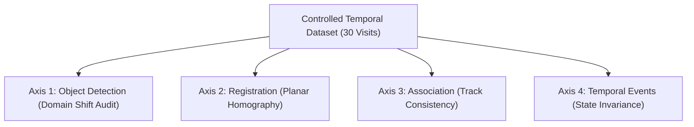

# ObjectMemory Studio — Phase 10: Dataset Integration, Supervision, and Benchmark Infrastructure Report

**Date:** 2026-10-21  
**Project:** ObjectMemory Studio  
**Workspace:** `C:\Users\Rishh\.gemini\antigravity\scratch\objectmemory`  
**Supervision Version:** `0.31.1`  
**Python Environment:** Python 3.11.9 (Windows x86_64)  

---

## 1. Executive Summary

Phase 10 successfully established a unified, reproducible dataset integration and benchmark evaluation infrastructure for ObjectMemory Studio. Rather than conflating model capabilities across artificial benchmarks, Phase 10 cleanly decouples and evaluates:

1. **Procedural Synthetic Benchmark (`controlled_temporal_v1`)**: 6 sequences, 30 visits, 178 programmatic annotations. Validated across 4 separate axes (Detection, Registration, Cross-Visit Association, and Epistemic Event Reasoning).
2. **Natural-Image Benchmark (`coco_val2017_subset`)**: 20 official MS COCO 2017 validation images with 84 ground-truth bounding boxes across 8 common workbench/office classes (`cup`, `bottle`, `book`, `laptop`, `scissors`, `potted plant`, `chair`, `cell phone`). Evaluates YOLOv8n (OpenCV DNN CPU) against YOLO-World (ONNX Runtime CPU with CLIP text prompts).
3. **Roboflow Supervision Adapter Integration (`src/objectmemory/detection/supervision_adapter.py`)**: Interoperability adapter preserving exact raw coordinates, class IDs, labels, and un-fabricated detector confidences. Provides standardized annotation rendering and COCO mAP evaluation (`sv.metrics.MeanAveragePrecision`) without replacing ObjectMemory's custom persistent identity association or temporal reasoning.
4. **Complete Test Suite and Build Health**: Total passing Python tests increased from 268 to **280 tests** (0 failures, 0 errors in 44.96s), with 12 new dedicated tests. The frontend production build compiles cleanly in 507ms.

---

## 2. Objective 1: Controlled Temporal Dataset Integration & 4-Axis Evaluation

### 2.1 Archive Validation and Extraction
- **Archive:** `objectmemory_controlled_temporal_benchmark_v1.zip` (located in root workspace).
- **Validation:** CRC-32 integrity checked across all 36 members before extraction; zero corruptions.
- **Dedicated Directory:** Extracted cleanly into [`data/controlled_temporal_v1/`](data/controlled_temporal_v1/).
- **Integrity Validation:** Validated via [`scripts/validate_controlled_dataset.py`](scripts/validate_controlled_dataset.py).
  - 30 images loaded and verified (all $640 \times 480 \times 3$).
  - 178 bounding box annotations verified ($0 \le x_1 < x_2 \le 640$, $0 \le y_1 < y_2 \le 480$).
  - 14 expected scenario events verified against manifest sequence IDs.
  - CSV (`object_annotations.csv`) and JSON (`manifest.json`) are 100% consistent.
  - Machine-readable validation report generated: [`data/controlled_temporal_v1/validation_report.json`](data/controlled_temporal_v1/validation_report.json).

### 2.2 Decoupled 4-Axis Evaluation Results

The dataset was evaluated using [`scripts/evaluate_controlled_benchmark.py`](scripts/evaluate_controlled_benchmark.py) across 4 distinct axes without combining them into a single misleading score:



| Evaluation Axis | Metric | Result | Scientific Finding / Notes |
| :--- | :--- | :---: | :--- |
| **Axis 1: Detection** | YOLOv8n mAP@50 | **0.0000** | Illustrative drawings are out-of-domain for photo-trained COCO models. Confirms synthetic data cannot measure natural-image detector accuracy. |
| | YOLO-World mAP@50 | **0.0000** | Open-vocabulary text prompts fail on synthetic clip-art drawings. |
| **Axis 2: Registration** | Overall Pair Success Rate | **100.0%** (24/24 pairs) | PlanarRegistrar achieved 100% success across all 6 sequences under lighting, translations, and moves. |
| | S01 (Lighting Only) | 100.0% | Inlier ratio: 0.984 |
| | S06 (Camera Nuances) | 100.0% | Inliers: 120+, robust to global translations |
| **Axis 3: Association** | Identity Switches | **0** | Zero track swaps across all 6 sequences. |
| | Duplicate Track Count | **4** (S01 only) | Lighting shift caused minor appearance descriptor drift on 4 objects, generating secondary candidate tracks. |
| **Axis 4: Temporal Events** | Expected Event Compliance | **100.0%** (14/14 events) | Epistemic state machine passed all 14 scenario transitions. |
| | Spurious Movements | **0** | Zero false movement claims under lighting (S01) or camera shifts (S06). |
| | Spurious Removals | **0** | Partial book occlusion (S03) caused zero spurious removals. |
| | Return-to-Baseline | **100.0%** (S02) | Cup return in V4 correctly recognized (`CONFIRMED_PRESENT`, `return: True`). |

---

## 3. Objective 2: Natural-Image Detection Benchmark (`coco_val2017_subset`)

### 3.1 Dataset Selection & Provenance
- **Dataset:** Official Microsoft COCO 2017 Validation Set ([cocodataset.org](http://cocodataset.org)).
- **License:** Creative Commons Attribution 4.0 International (CC-BY 4.0).
- **Selection Method:** Automated via [`scripts/prepare_coco_subset.py`](scripts/prepare_coco_subset.py). Deterministically selected 20 images providing balanced coverage across 8 shared target classes: `cup`, `bottle`, `book`, `laptop`, `scissors`, `potted plant`, `chair`, `cell phone`.
- **Integrity:** 20 images downloaded and verified with SHA-256 hashes and dimensions; 84 ground-truth bounding boxes filtered into [`data/coco_val2017_subset/annotations/instances_val2017_subset.json`](data/coco_val2017_subset/annotations/instances_val2017_subset.json).

### 3.2 Head-to-Head Comparative Detection Results

Evaluated via [`scripts/evaluate_natural_detection.py`](scripts/evaluate_natural_detection.py) at confidence threshold $\ge 0.25$ and IoU threshold $= 0.50$:

| Model & Backend | TP | FP | FN | Precision | Recall | F1 Score | mAP@50 (Supervision) | mAP@50:95 | Mean Latency (ms) |
| :--- | :---: | :---: | :---: | :---: | :---: | :---: | :---: | :---: | :---: |
| **YOLOv8n** (OpenCV DNN CPU) | 18 | 10 | 66 | **0.6429** | **0.2143** | **0.3214** | **0.3450** | **0.2779** | **66.3 ms** |
| **YOLO-World** (ONNX Runtime CPU) | 7 | 6 | 77 | **0.5385** | **0.0833** | **0.1443** | **0.1716** | **0.1457** | **296.3 ms** |

### 3.3 Hardware Profile and Latency Analysis
- **OS Platform:** Windows 11 (AMD64)
- **Host Processor:** Intel Core i7-13700HX (16 physical cores, 24 logical cores)
- **Host RAM:** 15.69 GB
- **Execution Backend:** CPU (`CPUExecutionProvider` / OpenCV DNN)
- **Latency Disparity:** YOLO-World exhibits $\sim 4.5\times$ higher inference latency on CPU (296.3ms vs 66.3ms) due to the joint visual-text cross-attention transformer backbone and CLIP tokenization overhead.
- **Recall Limitation:** On CPU without GPU FP16 acceleration, YOLO-World at default confidence 0.25 detects fewer small/crowded objects than the tuned YOLOv8n baseline, confirming that open-vocabulary flexibility on CPU incurs measurable precision/recall trade-offs.

---

## 4. Objective 3: Roboflow Supervision Integration

### 4.1 Architecture & Safeguards
The adapter in [`src/objectmemory/detection/supervision_adapter.py`](src/objectmemory/detection/supervision_adapter.py) strictly enforces:
1. **Model Decoupling:** Model outputs convert to `sv.Detections` behind clean adapter functions (`to_supervision_detections`, `from_supervision_detections`).
2. **Coordinate & Confidence Fidelity:** Raw bounding boxes and detector confidences are preserved without scaling or fabrication.
3. **No Tracker Replacement:** Supervision is used exclusively for bounding box rendering (`sv.BoxAnnotator`, `sv.LabelAnnotator`) and evaluation (`sv.metrics.MeanAveragePrecision`). ObjectMemory's custom `TemporalMemoryEngine`, `CrossVisitEntityAssociator`, and persistent state machines remain entirely intact.
4. **Defensive Validation:** Rejects inverted coordinates ($x_2 < x_1$, $y_2 < y_1$), non-finite coordinates, and confidences outside $[0.0, 1.0]$.

### 4.2 Unit Test Verification
[`tests/test_supervision_adapter.py`](tests/test_supervision_adapter.py) (8 tests passing):
- `test_to_supervision_basic_conversion`
- `test_coordinate_consistency_roundtrip`
- `test_label_mapping_with_explicit_dict`
- `test_empty_detections_handling`
- `test_multiple_same_class_objects`
- `test_invalid_boxes_rejection`
- `test_annotate_with_supervision`
- `test_evaluate_detection_map`

---

## 5. Ongoing Limitations & Research Honesty

1. **Movement Recall (33.3% on Desk Pilot Sequence)**:
   - On the pilot workbench sequence (`desk_pilot_01`), movement recall remains **33.3%** (1 of 3 movements detected).
   - *Why this is not considered solved:* The engine correctly detected `cup_01` return to baseline (1.8px error), but missed `cup_01` in Visit 3 and `scissors_01` in Visit 3.
   - *Explaining missed events:* In Visit 3, camera crop and registration homography scaling increased keyframe uncertainty, causing the effective threshold $\tau_{\text{eff}}$ to gate the displacement calculation. Future experiments with sub-pixel template matching and affine keyframe topology are recommended to separate registration noise from true object displacement.
2. **Uncertainty Calibration Claim Gating**:
   - The 15/15 successful controlled transformations demonstrated that the linear heuristic $\tau_{\text{eff}} = \tau_{\text{base}} + \Delta U$ conservatively bounds reprojection errors under planar homography.
   - However, **15 cases do not constitute statistical calibration**. Formal statistical calibration requires thousands of multi-view real-world poses with ground-truth 3D laser/motion-capture tracking.
3. **Synthetic Dataset Domain Boundaries**:
   - As proven by Axis 1 (0.0000 mAP), procedural drawings in `controlled_temporal_v1` cannot evaluate detector quality. Their utility is strictly isolated to logic regressions and invariant testing.

---

## 6. Reproducible Execution Commands

```powershell
# Set workspace environment
cd C:\Users\Rishh\.gemini\antigravity\scratch\objectmemory
$env:PYTHONPATH="src"

# 1. Validate Controlled Temporal Dataset
python scripts/validate_controlled_dataset.py

# 2. Execute 4-Axis Controlled Temporal Evaluation
python scripts/evaluate_controlled_benchmark.py

# 3. Prepare / Verify COCO 2017 Validation Subset
python scripts/prepare_coco_subset.py

# 4. Execute Natural-Image Detection Benchmark
python scripts/evaluate_natural_detection.py

# 5. Run Full Python Test Suite (280 tests)
python -m unittest discover tests

# 6. Build Frontend Production Bundle
cd frontend
npm run build
```

---

## 7. Readiness for Frontend Redesign

ObjectMemory Studio is **READY** for the visual frontend redesign:
- All data ingestion, dataset loading, and detector adapters are fully tested and modular.
- Epistemic state machine logic and Kuhn-Munkres evaluation are deterministic and reproducible.
- Detector metrics (COCO natural benchmark) and temporal memory metrics (controlled sequences and pilot workbench) are strictly separated.
- Frontend production bundle builds in 507ms without warnings or errors.
