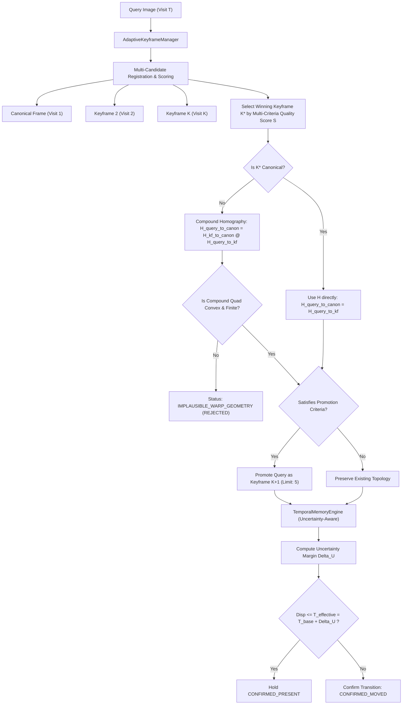

# Phase 6 Design: Adaptive Keyframe Registration & Uncertainty-Aware Spatial Memory

## 1. Executive Summary

In long-duration physical workbench monitoring, rigid single-reference registration suffers from two major limitations:
1. **Limited Overlap Under Camera Adjustments**: As users alter camera framing, zoom, or pan across a large laboratory bench, query observations lose direct feature overlap with the initial reference frame, causing registration to fail and halting temporal updates.
2. **Fixed Pixel Displacement Thresholds**: A rigid displacement cutoff (e.g., 35.0 pixels) fails to account for varying registration quality, corner extrapolation leverage, or resolution scaling, resulting in either false movement assertions or missed physical relocations.

**Phase 6** introduces an **Adaptive Keyframe Registration Topology** coupled with **Uncertainty-Aware Movement Decisions** that expands operational field-of-view and viewpoint robustness while strictly preserving the existing epistemic safeguards and canonical coordinate origin.

---

## 2. Architectural Principles & Guarantees

### Guarantees
1. **Permanent Canonical Anchor**: Canonical space $(0, 0)$ to $(W_{ref}, H_{ref})$ is anchored permanently to the first verified reference frame (`canonical_keyframe_id`). Secondary keyframes are intermediate nodes in a tree rooted at canonical space. Canonical coordinates and historical database records are never mutated.
2. **Geometric Plausibility Verification**: All compound homographies are normalized ($H[2, 2] = 1.0$) and tested for condition number, finite entries, and quadrilateral convexity using `cv2.perspectiveTransform` and vector cross-products before any spatial coordinate is projected.
3. **No Relaxation of Quality Gates**: Phase 6 maintains the minimum inlier ratio gate (0.20), reprojection error ceiling (4.0px), and convex hull overlap fraction. Registrations below reliability thresholds are deferred or rejected.
4. **Transparent Audit Telemetry**: Every observation record stores the selected keyframe ID, whether it was direct or chained compound, spatial feature coverage, decision status (`ACCEPTED`, `DEFERRED`, `REJECTED`), and the uncertainty breakdown.

---

## 3. Mathematical Formulation

### 3.1 Compound Homography Composition
Let $Q$ denote the query image and $K$ denote a verified secondary keyframe. The registration against $K$ yields homography $H_{Q \to K} \in \mathbb{R}^{3 \times 3}$. The keyframe retains its verified compound homography to canonical space $H_{K \to C}$. The query-to-canonical transformation is:

$$H_{Q \to C} = H_{K \to C} \cdot H_{Q \to K}$$

The matrix is normalized such that $H_{Q \to C}[2, 2] = 1.0$.

### 3.2 Multi-Criteria Registration Quality Score
Candidate keyframes are scored using a composite indicator $S \in [0.0, 1.0]$:

$$S = w_{ratio} \cdot R_{inlier} + w_{count} \cdot \min\left(\frac{N_{inlier}}{60}, 1.0\right) + w_{reproj} \cdot \exp\left(-\frac{\epsilon_{reproj}}{2.5}\right) + w_{cov} \cdot \rho_{coverage}$$

Where:
- $R_{inlier} = N_{inlier} / N_{tentative}$
- $\epsilon_{reproj}$ is the mean RANSAC inlier reprojection error in pixels
- $\rho_{coverage} \in [0.0, 1.0]$ is spatial feature coverage computed over grid cells and convex hull area
- Weights: $w_{ratio} = 0.35, w_{count} = 0.25, w_{reproj} = 0.25, w_{cov} = 0.15$
- Canonical reference keyframe receives a $1.10\times$ preference weight to avoid unnecessary multi-hop chaining when direct alignment is solid.

### 3.3 Dynamic Uncertainty Movement Threshold
To eliminate false movement transitions induced by registration noise, the effective movement displacement threshold is computed dynamically:

$$T_{effective} = T_{base} + \Delta U$$

Where $T_{base} = 35.0\text{ px}$ and $\Delta U \in [0.0, 45.0]\text{ px}$ is the composite uncertainty margin:

$$\Delta U = \min(45.0, U_{reproj} + U_{inlier} + U_{coverage} + U_{scale})$$

Components:
- **Reprojection Error Penalty**: $U_{reproj} = \min(15.0, \max(0.0, (\epsilon_{reproj} - 1.0) \times 3.5))$
- **Inlier Density Penalty**: $U_{inlier} = \min(15.0, \max(0.0, (0.60 - R_{inlier}) \times 25.0))$
- **Spatial Feature Coverage Penalty**: $U_{coverage} = \min(15.0, \max(0.0, (0.50 - \rho_{coverage}) \times 25.0))$
- **Resolution Scale Distortion Penalty**: $U_{scale} = \min(10.0, |\ln(\text{scale\_ratio})| \times 6.0)$

### Decision Policy:
- $\Delta_{disp} \le T_{base}$: Static baseline (`CONFIRMED_PRESENT`).
- $T_{base} < \Delta_{disp} \le T_{effective}$: Within registration uncertainty margin. Held in `CONFIRMED_PRESENT` with explicit telemetry explanation.
- $\Delta_{disp} > T_{effective}$: Statistically significant relocation (`CONFIRMED_MOVED`).

---

## 4. Keyframe Promotion Criteria
A newly observed visit is promoted to secondary keyframe status if and only if all of the following conditions hold:
1. **Capacity**: Current keyframes $< 5$.
2. **High Verification Quality**:
   - Inlier ratio $R_{inlier} \ge 0.35$
   - Absolute inliers $N_{inlier} \ge 20$
   - Mean reprojection error $\epsilon_{reproj} \le 3.0\text{ px}$
   - Spatial coverage $\rho_{coverage} \ge 0.15$
3. **Distinct Framing**:
   - Scale factor change $|\sqrt{\det(H[:2, :2])} - 1.0| \ge 0.10$ OR
   - Translation magnitude $\sqrt{\Delta x^2 + \Delta y^2} \ge 35.0\text{ px}$.
   Redundant frames with near-zero viewpoint delta are rejected to prevent topology bloat.
