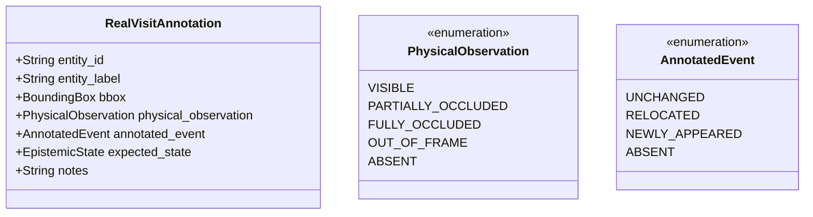

# Phase 7 Protocol: Real-World Dataset Collection & Ground-Truth Annotation

**Version**: 1.0  
**Target Application**: ObjectMemory Studio  
**Standard**: Independent Ground-Truth Decoupling (Research Protocol)

---

## 1. Scope & Objective

This document establishes the operational and scientific protocol for collecting, annotating, and validating multi-visit physical image sequences of real laboratory, workshop, and office workbench environments.

The guiding mandate of this protocol is **epistemic decoupling**:
> **Rule of Independence**: Ground truth must reflect verified physical facts established by the human experimenter. Detector predictions, bounding boxes, or confidence scores must never be converted into ground truth.

---

## 2. Physical Data Collection Guidelines

### 2.1 Environmental Calibration
When capturing photographs of a physical workbench across successive visits:
1. **Scene Composition**:
   - Track 5 to 15 distinct everyday objects (stationery, electronics, containers, tools, books).
   - Maintain at least 2 stationary "control" anchor objects (e.g., monitor stand, desk lamp base, large hardcover book) that are never moved throughout the entire sequence.
2. **Camera Sensor & Viewpoint**:
   - Record camera model and optical focal length.
   - Categorize camera viewpoint changes:
     - *Stable / Jitter*: Camera repositioned on tripod within $\pm 20\text{mm}$ translation, $< 2^\circ$ tilt.
     - *Translational Shift*: Lateral or vertical camera translation ($50\text{mm} - 300\text{mm}$).
     - *Perspective Tilt*: Angle change ($10^\circ - 35^\circ$) relative to bench normal.
     - *Resolution / Framing Scale*: Field-of-view change or optical zoom ($0.7\times - 1.5\times$).
3. **Illumination Variations**:
   - Document illumination changes between visits:
     - *Nominal Ambient*: Standard indoor diffuse overhead lighting.
     - *Directional Sunlight*: Harsh shadows from window daylight.
     - *Low Light*: Ambient overhead switched off, single accent or desk lamp active.

### 2.2 Chronological Monotonicity
Visits must be stamped with strict ISO 8601 UTC timestamps ($T_1 < T_2 < \dots < T_N$). Out-of-order visits violate causal temporal reasoning and will be rejected by dataset integrity checkers.

---

## 3. Annotation Schema & Decoupling

Manual annotations are recorded in `manifest.json` under each visit entry.



### 3.1 Object Identity & Class
- **`entity_id`**: A permanent unique identifier (e.g., `cup_01`, `scissors_01`) assigned when an object first enters the environment. This identifier **never changes**, even if the object is moved, occluded, removed, and later reintroduced.
- **`entity_label`**: The standard taxonomy category (e.g., `cup`, `scissors`, `notebook`).

### 3.2 Physical Observation States
Decoupled from detector confidence:
- **`VISIBLE`**: Object is observable on the workbench. Requires non-null `bbox: [x_min, y_min, x_max, y_max]`.
- **`PARTIALLY_OCCLUDED`**: Partially obscured by another object or framing edge, but identifiable. Requires non-null `bbox`.
- **`FULLY_OCCLUDED`**: Object is physically present behind an occluder (e.g. under a notebook), but zero pixels are visible. Bounding box must be `null`.
- **`OUT_OF_FRAME`**: Object is on the bench but outside the camera's current field of view. Bounding box must be `null`.
- **`ABSENT`**: Object was physically taken off the workbench. Bounding box must be `null`.

### 3.3 Physical Change Events
- **`UNCHANGED`**: Object remained in its prior physical position ($\Delta < 15\text{mm}$).
- **`RELOCATED`**: Object was physically moved to a new position ($\Delta \ge 35\text{mm}$).
- **`NEWLY_APPEARED`**: Object placed on the workbench for the first time.
- **`ABSENT`**: Object is not on the bench.

### 3.4 Handling Ambiguity
If physical reality cannot be determined from the photographic record (e.g., whether scissors were removed before placing a notebook or are hidden underneath):
- Do **not** invent occlusions or removals.
- Flag the visit in the `notes` field.
- Document the conservative annotation decision explicitly.

---

## 4. Verification Workflow

Dataset integrity must be automatically verified before running evaluations:

```bash
python scripts/dataset_tool.py validate path/to/manifest.json
python scripts/dataset_tool.py summary path/to/manifest.json
```

The validator verifies:
1. Strict monotonicity of timestamps.
2. Readability of all referenced image files.
3. No conflicting entity class labels for identical `entity_id` across visits.
4. Logical consistency between `physical_observation` and `bbox` (e.g. `ABSENT` cannot have a non-null bbox; `VISIBLE` must have a bbox).
5. Semantic consistency between `annotated_event` and `expected_state`.

---

## 5. Dataset Inventory & Current Limitation Disclosure

### Current Available Real Data
- **`data/real_workbench/manifest.json` (`desk_pilot_01`)**:
  - 7 physical visit photographs (`visit_01.png` to `visit_07.png`).
  - 7 unique tracked physical objects (`plant_01`, `cup_01`, `cup_02`, `bottle_01`, `scissors_01`, `book_01`, `notebook_01`).
  - Evaluated branches: stable stationary, relocation, removal progression, re-appearance after removal, ambiguous occlusion.

### Honest Scientific Limitation Disclosure
> [!IMPORTANT]
> No additional unannotated real workbench image sequences exist in the repository beyond `desk_pilot_01`. Therefore, Phase 7 does **not** claim additional real-world validation on newly collected physical sequences. Instead, Phase 7 uses `desk_pilot_01` for reproducible physical evaluation, specifies this formalized dataset protocol for future multi-lab data collection, and utilizes controlled synthetic experiments to systematically evaluate corner cases (such as wide-angle panning and variable focal lengths) that cannot be safely inferred from a single 7-visit desk sequence.
