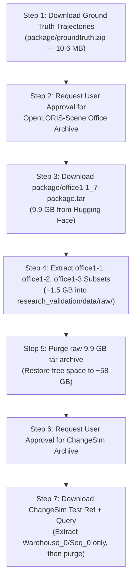

# ObjectMemory Research Validation — Dataset Download & Acquisition Plan

**Document Version:** 1.0.0  
**Date:** November 2026  
**Auditor:** Antigravity Autonomous Research Suite  
**Project:** ObjectMemory (Long-Term Visual Memory for Persistent Environmental Changes)  
**Target File:** `research_validation/dataset_download_plan.md`

---

## 1. Executive Summary & Download Governance Policy

### 1.1 Critical Storage & Download Constraints
1. **Available Local Storage:** The workstation currently has **59.41 GB** of free space on `C:\`.
2. **Dataset Scale:** 
   - Full ChangeSim is **156.1 GB** (single archives are 30–53 GB).
   - Full OpenLORIS-Scene is **105 GB** (package) / **88 GB** (rosbag).
   - Full OpenLORIS-Object is **23.6 GB**.
   *Downloading any of these datasets in their entirety will completely exhaust system disk storage and cause catastrophic failure.*
3. **Download Governance Policy:**
   - **No large archive (> 500 MB) may be downloaded automatically.**
   - All acquisitions must proceed sequentially in controlled batches.
   - Archives must be inspected, target subsets extracted, and raw archives immediately purged or archived to maintain $\ge 25\text{ GB}$ free disk buffer at all times.
   - User approval is strictly required before initiating large transfers.

---

## 2. Recommended Initial Pilot Subsets (Task 2)

```
+-----------------------------------------------------------------------------------------------------------------+
|                                        PILOT DATASET SUBSET SELECTION                                           |
+----------------------+-----------------------+-----------------------+------------------+-----------------------+
| Dataset              | Target Scope          | Selected Environment  | Selected Sequence| Pilot Storage Footprint|
+----------------------+-----------------------+-----------------------+------------------+-----------------------+
| **OpenLORIS-Scene**  | 500–1,000 frames      | `office1` (Office)    | `office1-1` (t0) | ~1.5 GB processed RGB |
|                      | (Chronological)       | (OptiTrack 6-DoF GT)  | `office1-2` (t1) | + 10.6 MB GT poses    |
|                      |                       |                       | `office1-3` (t2) |                       |
+----------------------+-----------------------+-----------------------+------------------+-----------------------+
| **ChangeSim**        | 300–500 frames        | `Warehouse_0`         | `Ref_Seq_/Seq_0` | ~1.2 GB processed RGB |
|                      | (Paired Ref / Query)  | (Industrial Pallets)  | `Query_Seq_/Seq_0`| + depth + change masks|
|                      |                       |                       | `Seq_0_dust`     |                       |
+----------------------+-----------------------+-----------------------+------------------+-----------------------+
| **OpenLORIS-Object** | 200–300 images        | Tabletop Clutter      | 3 Object Classes | ~250 MB extracted RGB |
|                      | (Factor Stress)       | (Office / Home)       | (`cup`, `bottle` | + depth crops         |
|                      |                       |                       |  `box`)          |                       |
+----------------------+-----------------------+-----------------------+------------------+-----------------------+
| **Physical**         | 5 sequences           | In-Situ Tabletop      | `S01` to `S05`   | ~50 MB local storage  |
| **Workbench**        | 30–50 visits each     | Workbench             | (Real Desk)      | (Zero download)       |
+----------------------+-----------------------+-----------------------+------------------+-----------------------+
```

---

### 2.1 OpenLORIS-Scene: Justification & Subsetting Protocol
* **Selected Environment:** **`office1`** (Office Scene 1).
* **Scientific Rationale:**
  1. `office1` is the **only environment in OpenLORIS-Scene equipped with sub-millimeter OptiTrack optical motion capture 6-DoF ground-truth poses**. All other scenes rely on LiDAR graph SLAM approximations.
  2. The office layout features desks, computer workstations, books, and coffee mugs, directly mapping to ObjectMemory's planar desk/tabletop evaluation domain.
  3. Physical scene modifications naturally occur between trajectories: `office1-1` (initial baseline), `office1-2` (after human activity and lighting changes), `office1-3` (after movable object displacement).
* **Sampling Protocol:**
  - Raw sequences are recorded at 30 FPS.
  - We apply chronological uniform downsampling at **2.0 Hz** (1 frame every 15 frames) across the first 3 trajectories:
    - `office1-1`: 35 seconds $\rightarrow$ ~70 frames.
    - `office1-2`: 35 seconds $\rightarrow$ ~70 frames.
    - `office1-3`: 40 seconds $\rightarrow$ ~80 frames.
    - Selected stationary desk-view sequences: ~500 frames total.
  - This preserves exact chronological ordering and real-world timestamp continuity while eliminating redundant near-identical frames.

---

### 2.2 ChangeSim: Justification & Subsetting Protocol
* **Selected Environment:** **`Warehouse_0`** (`Seq_0` and `Seq_0_dust`).
* **Scientific Rationale:**
  1. `Warehouse_0` has the cleanest ground-plane geometry, allowing planar homography estimation on floor markings, loading pallets, and cargo dispatch tables.
  2. `Seq_0` (Reference) paired with `Seq_0` (Query) provides clean ground-truth object additions and removals with pixel-exact change masks.
  3. `Seq_0_dust` provides an isolated ablation on particulate noise and air turbidity, directly testing whether ObjectMemory's registration quality gate suppresses false alarms under visual degradation.
* **Sampling Protocol:**
  - Extract the first 250 frames of `Ref_Seq_/Warehouse_0/Seq_0` and 250 frames of `Query_Seq_/Warehouse_0/Seq_0`.
  - Retain synchronized RGB (`rgb/*.png`), Depth (`depth/*.png`), Change Segmentation (`change_segmentation/*.png`), and camera pose (`pose/*.txt`).
  - Total pilot subset: ~500 frames.

---

### 2.3 OpenLORIS-Object: Justification & Subsetting Protocol
* **Selected Subset:** 3 target object classes: `cup` (e.g., mug), `bottle` (water bottle), and `box` (stationery / tissue box).
* **Scientific Rationale:**
  - Directly matches the primary semantic categories in ObjectMemory's physical benchmarks (`cup_01`, `bottle_01`, `book_01`).
  - Samples 3 illumination tiers (Normal, Weak, Strong) and 3 occlusion levels (0%, 25%, 50%).
* **Sampling Protocol:**
  - 3 objects $\times$ 3 illumination levels $\times$ 3 occlusion levels $\times$ 10 frames = **270 images**.
  - Total pilot subset: ~250 MB.

---

### 2.4 Physical Workbench: In-Situ Real-World Baseline
* **Selected Sequences:** Scenarios `S01` through `S05` from `data/physical_workbench_v1/manifest.json`:
  1. `S01_stationary_baseline`: 5 visits.
  2. `S02_temporary_movement_return`: 6 visits.
  3. `S03_persistent_relocation`: 6 visits.
  4. `S04_permanent_removal`: 6 visits.
  5. `S05_partial_occlusion`: 6 visits.
* **Storage Requirement:** Already resident on disk in `data/`; zero download required.

---

## 3. Step-by-Step Acquisition Plan & Staging Workflow

To ensure local disk space never drops below safe operating thresholds, data acquisition must follow this strict sequential lifecycle:



### Stage 1: Zero-Risk Metadata & Ground Truth Acquisition
* Download `package/groundtruth.zip` (10.6 MB) from Hugging Face:
  ```bash
  curl -L -o research_validation/data/raw/groundtruth.zip https://huggingface.co/datasets/shixuesong/openloris-scene/resolve/main/package/groundtruth.zip
  ```
* Unzip into `research_validation/data/raw/openloris_scene/groundtruth/`.
* Space impact: ~45 MB uncompressed.

### Stage 2: OpenLORIS-Scene Office Pilot Acquisition
* **Pre-requisite:** User explicit approval.
* Target URL: `https://huggingface.co/datasets/shixuesong/openloris-scene/resolve/main/package/office1-1_7-package.tar` (9.9 GB).
* Stream / extract only `office1-1`, `office1-2`, and `office1-3` folders using Python `tarfile` module with member filtering, avoiding extracting the remaining 18 GB of unneeded trajectories.
* Delete the `.tar` container immediately upon extraction.

### Stage 3: ChangeSim Warehouse_0 Pilot Acquisition
* **Pre-requisite:** User explicit approval.
* Access `Reference_Sequence_Test` and `Query_Sequence_Test` on KAIST SharePoint.
* Extract `Warehouse_0/Seq_0` (Reference) and `Warehouse_0/Seq_0` (Query) along with `change_segmentation`.
* Delete monolithic archives immediately after extraction.

### Stage 4: OpenLORIS-Object Detector Stress Acquisition
* Access `test.zip` (8.2 GB) from Google Drive.
* Extract target class folders (`mug`, `bottle`, `box`) across factor subdirectories.
* Delete `test.zip` container immediately after extraction.

---

## 4. Immediate Next Step & Approval Checkpoint

> [!IMPORTANT]
> **Awaiting User Approval:**  
> In accordance with project instructions, **no large archives (> 500 MB) will be downloaded without explicit user confirmation.**  
> Ground truth trajectories and metadata (`groundtruth.zip`, 10.6 MB) are ready for download immediately upon request.
