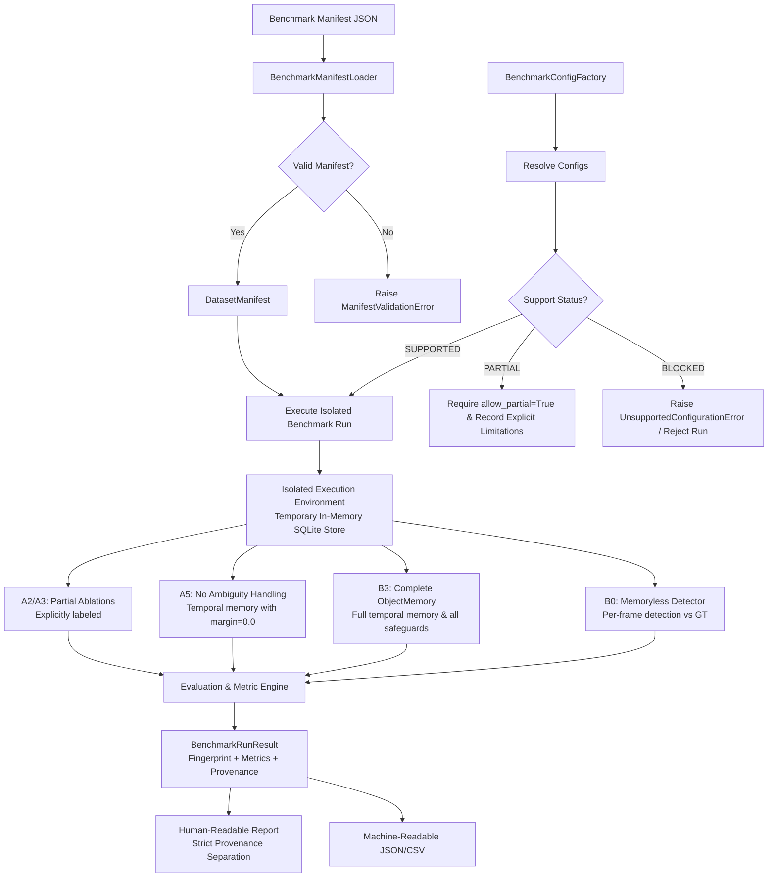

# ObjectMemory: Phase 3C Evaluation Runner Design & Compatibility Audit
**Project:** ObjectMemory: Long-Term Visual Memory for Detecting Persistent Environmental Changes  
**Workspace:** `C:\Users\Rishh\.gemini\antigravity\scratch\objectmemory`  
**Phase:** 3C (Benchmark Evaluation Runner)  
**Status:** DESIGN & AUDIT COMPLETE — READY FOR IMPLEMENTATION  

---

## 1. Stage 1: Pre-Implementation Interface & Compatibility Audit

### 1.1 Manifest Loader Interface (`src/objectmemory/benchmarks/manifest.py`)
Phase 3A.1 established strict schema and chronological validation for multi-sequence evaluation manifests:
- **`BenchmarkManifestLoader.load_manifest(manifest_path, dataset_root=None, validate_files=True)`**:
  - Ingests v1.0 and v2.0 JSON manifests.
  - Enforces path-traversal safety (all paths must resolve strictly within `dataset_root`).
  - Strict chronological order enforcement (`timestamp` must be monotonically non-decreasing).
  - Validates bounding box geometry ($x_{\min} < x_{\max}$, $y_{\min} < y_{\max}$) and canonical vocabularies (`VisibilityStatus`, `EpistemicState`).
- **Data Structures**:
  - `DatasetManifest`: Top-level container holding `manifest_version`, `dataset_name`, `dataset_root`, `provenance: DatasetProvenance`, `sequences: List[SequenceEntry]`.
  - `DatasetProvenance`: Enum with values `GENUINE_PHYSICAL`, `SYNTHETIC_GENERATED`, `EXPLORATORY_PILOT`, `PUBLIC_BENCHMARK`, `UNKNOWN`.
  - `manifest.is_genuine_physical`: Strict boolean checking `provenance == DatasetProvenance.GENUINE_PHYSICAL`.
  - `manifest.is_pilot_dataset`: Identifies exploratory pilots (e.g. `desk_pilot_01`).
  - `SequenceEntry`: Contains ordered `ObservationEntry` objects, challenge mode, reference image, and calibration file.
  - `ObservationEntry`: Represents a single visit with `observation_id`, `timestamp`, `image_path` (resolved `Path`), and `objects: List[ObjectAnnotationEntry]`.
  - `ObjectAnnotationEntry`: Holds `object_id`, `class_name`, `bounding_box: Optional[BoundingBox]`, `visibility_status`, `object_state`, `timestamp`, and `metadata`.

### 1.2 Configuration Factory Interface (`src/objectmemory/benchmarks/config_factory.py`)
Phase 3B implemented immutable, deterministic benchmark configurations:
- **`BenchmarkConfigFactory.create_config(config_id, allow_blocked=False, allow_partial=False) -> BenchmarkConfig`**:
  - `config_id in {"B0", "B1", "B2", "B3", "A1", "A2", "A3", "A4", "A5", "A6"}`.
  - Evaluates support status:
    - `SUPPORTED`: `B0`, `B3`, `A5`.
    - `PARTIALLY_SUPPORTED`: `A2`, `A3` (requires `allow_partial=True`).
    - `BLOCKED`: `B1`, `B2`, `A1`, `A4`, `A6` (raises `UnsupportedConfigurationError` unless `allow_blocked=True`).
- **Data Structures**:
  - `BenchmarkConfig`: Frozen dataclass with `config_id`, `name`, `description`, `support_status`, `pipeline_type`, `temporal_config`, `enabled_safeguards`, `disabled_safeguards`, `effective_parameters`.
  - `deterministic_hash`: SHA-256 fingerprint computed from deterministic JSON serialization.
  - `get_isolated_temporal_config()`: Decoupled deep-copy of `TemporalEngineConfig`.

### 1.3 Ground-Truth Matcher & Baseline Comparator
- **Bipartite Assignment (`baseline/comparator.py`)**:
  - `calculate_bbox_iou(box1, box2) -> float` (in $[0.0, 1.0]$).
  - `calculate_centroid_distance(box1, box2) -> Optional[float]`.
  - `solve_optimal_assignment(cost_matrix)`: Hungarian Kuhn-Munkres matching.
- **Ground-Truth to Track Binding (`benchmarks/ground_truth_matcher.py` & `scripts/evaluate_physical_workbench.py`)**:
  - Ground-truth annotations are matched to system tracks using 1-to-1 bipartite matching based on bounding-box overlap and centroid proximity under class constraints.
  - Uninstantiated ground-truth entities (never detected or matched) are strictly tracked and never credited as correct predictions.
  - Spurious/unmatched system tracks are isolated and counted toward duplicate identities.

### 1.4 Temporal Engine & Pipeline Execution Interfaces
- **`TemporalMemoryEngine` (`temporal/engine.py`)**:
  - Requires `store: SQLiteMemoryStore`, `config: TemporalEngineConfig`, `signature_extractor: VisualSignatureExtractor`.
  - `process_visit(visit_input: VisitInput) -> VisitProcessingReport`:
    - Performs cross-visit association with active entities.
    - Updates belief states: `CONFIRMED_PRESENT`, `CONFIRMED_MOVED`, `PENDING_REMOVAL`, `CONFIRMED_REMOVED`, `INSUFFICIENT_EVIDENCE`, `AMBIGUOUS_IDENTITY`.
    - Freezes absence updates when registration fails (`registration.success=False`).
    - Gated vacancy verification prevents false removal from transient occlusions or viewpoint limits.
- **`RealImagePipelineRunner` (`pipeline/real_pipeline.py`)**:
  - Chains `PlanarRegistrar` -> `ObjectDetector` -> `transform_bbox_to_canonical` -> `VisualSignatureExtractor` -> `TemporalMemoryEngine`.
  - Accepts pluggable `store` and `temporal_config`.

---

## 2. Stage 2: Benchmark Runner Architecture

### 2.1 Component Overview
The benchmark runner will be implemented in:
`src/objectmemory/benchmarks/runner.py`



### 2.2 Execution Isolation Model
To ensure complete scientific reproducibility and avoid corrupting test or production databases:
1. **Per-Sequence, Per-Configuration SQLite Store**:
   - Every configuration evaluated on every sequence instantiates a dedicated `SQLiteMemoryStore(":memory:")`.
   - The store is initialized, used exclusively for that sequence, and discarded upon completion.
   - No shared global state, static caches, or production SQLite files (`data/objectmemory.db`) are ever accessed or written.
2. **Error Containment**:
   - An execution error on one sequence or configuration is captured into the `BenchmarkRunResult.execution_errors` dictionary.
   - It does not abort or contaminate subsequent sequence evaluations.
3. **Reproducibility Guarantee**:
   - The runner records the configuration ID, SHA-256 `deterministic_hash`, and the full dictionary of `effective_parameters`.
   - Given identical images and deterministic detector/feature inputs, repeated runs yield byte-identical metric evaluations.

---

## 3. Stage 3: Operational Pipeline per Configuration

### 3.1 B0: Memoryless Detector Baseline
- **Role**: Experimental control establishing raw detector performance without temporal persistence.
- **Pipeline**:
  1. For each observation $t$, run `detector.detect(image)` yielding detections $D_t$.
  2. Perform Kuhn-Munkres 1-to-1 matching between $D_t$ and ground-truth objects in observation $t$ (using IoU $\ge 0.50$ and label match).
  3. Predictions:
     - Matched GT object $\implies$ `CONFIRMED_PRESENT` at observation $t$.
     - Unmatched GT object with visible ground truth $\implies$ `UNOBSERVED` (missed detection).
     - Unmatched GT object with absent ground truth $\implies$ `UNOBSERVED` (no detection).
  4. Memoryless Property:
     - B0 has no entity memory, no cross-session tracks, and no concept of persistent state.
     - It **never** predicts `CONFIRMED_REMOVED` or `CONFIRMED_MOVED`.
     - Consequently, False Removal Rate = $0.0$, Removal Recall = $0.0$, Unsupported Movement Rate = $0.0$, and Identity Consistency is unapplicable / $0.0$.

### 3.2 B3: Complete ObjectMemory (Full Proposed System)
- **Role**: Primary experimental system featuring all 10 epistemic safeguards.
- **Pipeline**:
  1. Keyframe/Planar registration aligns query image with canonical reference image.
  2. Detector predicts candidate objects.
  3. Reliable registration projects bounding boxes into canonical coordinate frame; visual signature extractor obtains 148-d feature vectors from image crops.
  4. `TemporalMemoryEngine` performs cross-visit Hungarian association with ambiguity gating ($\Delta \text{sim} < 0.12$).
  5. Multi-visit state progression:
     - Observation 1 unobserved $\implies$ `PENDING_REMOVAL`.
     - Observation 2 vacant $\implies$ `CONFIRMED_REMOVED` (only if registration succeeded and patch similarity $< 0.40$).
     - Unaligned frame $\implies$ absence evaluation frozen (`INSUFFICIENT_EVIDENCE`).
     - Coordinate displacement $> 35.0$ px $\implies$ `CONFIRMED_MOVED` (gated by drift and boundary clipping safeguards).

### 3.3 A5: No Ambiguity Handling Ablation
- **Role**: Evaluates the specific scientific contribution of visual ambiguity gating.
- **Pipeline**:
  - Identical to B3, but `ambiguity_margin = 0.0`.
  - When two candidate detections compete for an entity with near-identical visual appearance, A5 forcefully binds the highest scorer rather than flagging `AMBIGUOUS_IDENTITY`.

### 3.4 A2 & A3: Partially Supported Ablations (Opt-in Only)
- **A2 (No Vacancy Verification)**:
  - Configured via `vacancy_similarity_max = 1.0`.
  - Explicit Limitation: Bypasses patch similarity checking for valid crops, but frames missing aligned images still trigger unobserved visit logic. Must be marked with `is_partial_ablation=True`.
- **A3 (No Visibility / FOV Safeguards)**:
  - Configured via `min_overlap_fraction = 0.0`.
  - Explicit Limitation: Disables bounding box FOV boundary checks, but inter-object occlusion IoU gating ($0.20$) remains hardcoded. Must be marked with `is_partial_ablation=True`.

### 3.5 Rejection of Blocked Configurations
- Configurations `B1`, `B2`, `A1`, `A4`, and `A6` are fundamentally unexecutable in the current engine without breaking production database schemas or rewriting state transition logic.
- The runner must explicitly reject them with `UnsupportedConfigurationError` before execution begins.

---

## 4. Stage 4: Formal Metric Definitions & Mathematical Formulations

To ensure scientific correctness and prevent distorted claims, each metric is explicitly defined with its exact numerator, denominator, exclusions, and zero-denominator behavior.

### 4.1 False Removal Rate ($FRR$)
- **Purpose**: Measures the tendency of the system to prematurely or erroneously declare an object permanently removed when it is actually still present or merely unobserved.
- **Numerator**: Count of evaluations where ground truth is physically present (or in any non-removed state: `CONFIRMED_PRESENT`, `CONFIRMED_MOVED`, `PARTIALLY_OCCLUDED`, `HEAVILY_OCCLUDED`), but the system predicts `CONFIRMED_REMOVED`.
  $$\text{Numerator}_{FRR} = \sum_{i} \mathbb{I}(\text{GT}_i \neq \text{REMOVED} \land \text{Pred}_i = \text{CONFIRMED\_REMOVED})$$
- **Denominator**: Total number of evaluations where the ground-truth object is physically present or non-removed.
  $$\text{Denominator}_{FRR} = \sum_{i} \mathbb{I}(\text{GT}_i \neq \text{REMOVED})$$
- **Excluded Cases**: Visits where ground truth is genuinely `CONFIRMED_REMOVED`. Ground-truth entities that were never instantiated/detected.
- **Safeguard**: System predictions of `PENDING_REMOVAL`, `INSUFFICIENT_EVIDENCE`, or `AMBIGUOUS_IDENTITY` are epistemic abstentions, **not** confirmed removals; they must never be counted as false removals.
- **Zero Denominator**: Returns `None` (formatted as `"N/A"`).

### 4.2 Removal Recall ($RR$)
- **Purpose**: Measures the ability of the system to correctly identify and confirm genuine physical removals.
- **Numerator**: Count of evaluations where ground truth is `CONFIRMED_REMOVED` and the system prediction is `CONFIRMED_REMOVED`.
  $$\text{Numerator}_{RR} = \sum_{i} \mathbb{I}(\text{GT}_i = \text{REMOVED} \land \text{Pred}_i = \text{CONFIRMED\_REMOVED})$$
- **Denominator**: Total number of evaluations where ground truth is `CONFIRMED_REMOVED`.
  $$\text{Denominator}_{RR} = \sum_{i} \mathbb{I}(\text{GT}_i = \text{REMOVED})$$
- **Excluded Cases**: Visits where the object is physically present, occluded, or unobserved due to camera viewpoint rather than genuine removal.
- **Zero Denominator**: Returns `None` (formatted as `"N/A"`).

### 4.3 Unsupported Movement Rate ($UMR$)
- **Purpose**: Measures false movement alarms triggered on stationary objects due to coordinate drift, registration jitter, or boundary clipping.
- **Numerator**: Count of evaluations where the ground-truth object is stationary (expected state `CONFIRMED_PRESENT` with zero displacement), but the system predicts `CONFIRMED_MOVED`.
  $$\text{Numerator}_{UMR} = \sum_{i} \mathbb{I}(\text{GT}_i = \text{STATIONARY} \land \text{Pred}_i = \text{CONFIRMED\_MOVED})$$
- **Denominator**: Total number of evaluations where the ground-truth object is stationary.
  $$\text{Denominator}_{UMR} = \sum_{i} \mathbb{I}(\text{GT}_i = \text{STATIONARY})$$
- **Excluded Cases**: Visits where the object was genuinely relocated (`CONFIRMED_MOVED` in ground truth), removed, or out of frame.
- **Zero Denominator**: Returns `None` (formatted as `"N/A"`).

### 4.4 Identity Consistency ($IC$)
- **Purpose**: Measures track continuity for persistent entities across repeated visits.
- **Formulation**: For each ground-truth entity $g$, let $N(g, s)$ denote the number of visits in which $g$ is assigned to system entity $s$. The dominant system entity is $s^*(g) = \arg\max_s N(g, s)$.
  $$IC = \frac{\sum_{g} \max_{s} N(g, s)}{\sum_{g} \sum_{s} N(g, s)}$$
- **Numerator**: Sum of visit counts for each entity's dominant system ID: $\sum_{g} \max_s N(g, s)$.
- **Denominator**: Total number of instantiated entity-visits matched to any system track: $\sum_{g, s} N(g, s)$.
- **Excluded Cases**: Uninstantiated ground-truth entities (entities never detected); visits where the object was absent/unobserved.
- **Zero Denominator**: Returns `None` (formatted as `"N/A"`).

### 4.5 ID Switches ($IDS$)
- **Purpose**: Quantifies fragmentation of object identities over time.
- **Formulation**: For each ground-truth entity $g$ observed at consecutive visits $t_{k-1}$ and $t_k$:
  $$IDS = \sum_{g} \sum_{k} \mathbb{I}\Big(s(g, t_k) \neq s(g, t_{k-1}) \;\land\; s(g, t_k) \neq \text{None} \;\land\; s(g, t_{k-1}) \neq \text{None}\Big)$$
- **Denominator**: Total consecutive observed transitions $\sum_g (K_g - 1)$ where $K_g$ is the number of observed visits for entity $g$.
- **Excluded Cases**: The initial visit an entity is observed (initial track creation); visits where the entity was unobserved or absent.
- **Zero Denominator**: Returns integer `0` for switch count; switch rate returns `None` if zero transitions exist.

### 4.6 Duplicate Identities ($DI$)
- **Purpose**: Detects track over-generation (spurious parallel tracks instantiated for the same physical object).
- **Formulation**:
  $$DI = \max\Big(0, \; |\text{System Entities Instantiated}| - |\text{Unique GT Entities Present}|\Big)$$
  Additionally, the runner records the count of completely spurious system tracks that never match any ground-truth annotation throughout the sequence.
- **Excluded Cases**: None.
- **Zero Denominator**: N/A (absolute integer count).

### 4.7 Confirmation Delay ($CD$)
- **Purpose**: Measures the temporal latency (in visits) required to transition an epistemic belief from candidate/pending to confirmed.
- **Formulation**: For each confirmed change event $e$ (removal or movement) occurring at visit $t_{\text{onset}}$ and first confirmed by the system at visit $t_{\text{confirm}}$:
  $$\text{Delay}(e) = t_{\text{confirm}} - t_{\text{onset}}$$
  $$\text{Confirmation Delay} = \frac{\sum_{e \in E_{\text{confirmed}}} \text{Delay}(e)}{|E_{\text{confirmed}}|}$$
- **Numerator**: Sum of visit delays over all successfully confirmed change events.
- **Denominator**: Total number of successfully confirmed change events $|E_{\text{confirmed}}|$.
- **Excluded Cases**: Change events that were never confirmed (missed events); stationary visits.
- **Zero Denominator**: Returns `None` (formatted as `"N/A"`).

### 4.8 Historical Retrieval Accuracy ($HRA$)
- **Purpose**: Evaluates re-identification accuracy when a previously removed or absent object reappears in the scene.
- **Numerator**: Number of reappearance events where the returned object was correctly re-associated with its original historical `entity_id`.
- **Denominator**: Total number of ground-truth return-to-baseline / reappearance events for entities with a previously established identity.
- **Ground-Truth Requirement**: Only scorable if the benchmark sequence contains explicit annotations of reappearance/return (e.g. `expected_event == "return_to_baseline"` or `"reappeared"`).
- **Excluded Cases**: Sequences without return/reappearance events.
- **Zero Denominator**: Returns `None` (formatted as `"N/A"`).

---

## 5. Stage 5: Output Schema & Provenance Separation

### 5.1 Machine-Readable JSON Schema (`BenchmarkRunResult`)
```json
{
  "run_id": "c1f7b09e-71a2-4a7b-8324-4d69317d6e40",
  "timestamp": "2026-11-14T09:15:00Z",
  "dataset_name": "real_workbench",
  "dataset_provenance": "GENUINE_PHYSICAL",
  "is_pilot_dataset": false,
  "sequence_ids": ["S01_stationary_baseline", "S04_permanent_removal"],
  "config_id": "B3",
  "config_name": "Complete ObjectMemory (Full Proposed System)",
  "config_fingerprint": "a3b9f4e2...",
  "pipeline_type": "FULL_TEMPORAL_MEMORY",
  "is_partial_ablation": false,
  "partial_ablation_limitations": [],
  "effective_parameters": {
    "ambiguity_margin": 0.12,
    "vacancy_similarity_max": 0.40,
    "vacancy_visits_for_removal": 2,
    "min_registration_inlier_ratio": 0.20,
    "min_overlap_fraction": 0.70,
    "movement_displacement_threshold": 35.0
  },
  "metrics": {
    "total_observations_processed": 10,
    "total_entity_evaluations": 42,
    "false_removal_rate": 0.0,
    "removal_recall": 1.0,
    "unsupported_movement_rate": 0.0,
    "identity_consistency": 1.0,
    "id_switches": 0,
    "duplicate_identities": 0,
    "mean_confirmation_delay_visits": 2.0,
    "historical_retrieval_accuracy": null
  },
  "unscorable_cases": {
    "historical_retrieval_accuracy": "No return-to-baseline events present in evaluated sequences."
  },
  "uninstantiated_gt_entities": [],
  "execution_errors": {},
  "runtime_seconds": 1.84
}
```

### 5.2 Scientific Reporting & Provenance Separation
The runner generates a standardized ASCII / Markdown report enforcing strict provenance boundaries:
- **`GENUINE_PHYSICAL`**: Real-world photographs captured under verified multi-session physical workbench protocols.
- **`EXPLORATORY_PILOT`**: Preliminary pilot captures (e.g. `desk_pilot_01`).
  - **MANDATORY WARNING**: *"This report contains exploratory pilot data. Pilot datasets must NEVER be represented as final physical-world validation."*
- **`SYNTHETIC_GENERATED`**: Programmatically generated or simulated sequences.
- **`PUBLIC_BENCHMARK`**: External standardized benchmarks (e.g. OpenLORIS).

---

## 6. Verification Plan & Test Matrix

The following test suites will be implemented in `tests/test_benchmark_runner.py`:
1. `test_manifest_loading_and_validation`: Ingestion of valid manifest and rejection of invalid/corrupt manifest.
2. `test_blocked_configuration_rejection`: Verification that B1, B2, A1, A4, and A6 are strictly rejected prior to execution.
3. `test_partial_ablation_labeling`: Verification that A2 and A3 require `allow_partial=True` and record explicit limitation notes.
4. `test_database_isolation`: Verification that temporary in-memory databases are used and production databases are untouched.
5. `test_b0_memoryless_execution`: B0 evaluates per-frame detections, produces zero false removals, and maintains zero temporal state.
6. `test_b3_full_system_execution`: B3 executes end-to-end with all safeguards active.
7. `test_a5_ambiguity_ablation_execution`: A5 executes with `ambiguity_margin = 0.0` and correctly binds ambiguous candidates.
8. `test_hand_calculated_metrics`: Deterministic calculation of FRR, RR, UMR, IC, IDS, DI, CD against synthetic hand-verified ground truth.
9. `test_zero_denominator_behavior`: Confirms that division-by-zero returns `None` rather than failing or reporting synthetic zeros.
10. `test_unobservable_and_missing_annotations`: Unobservable and out-of-frame objects are not falsely scored as confirmed removals.
11. `test_registration_failure_handling`: Registration failure freezes absence and sets spatial coordinates to `UNKNOWN`.
12. `test_reproducibility_across_runs`: Repeated runs with identical inputs produce identical hashes and metrics.
13. `test_provenance_warning_enforcement`: Pilot dataset outputs contain the mandatory non-equivalence warning.
